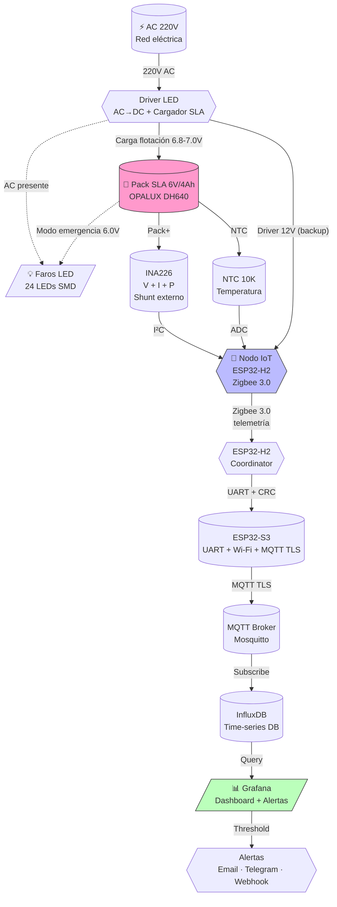
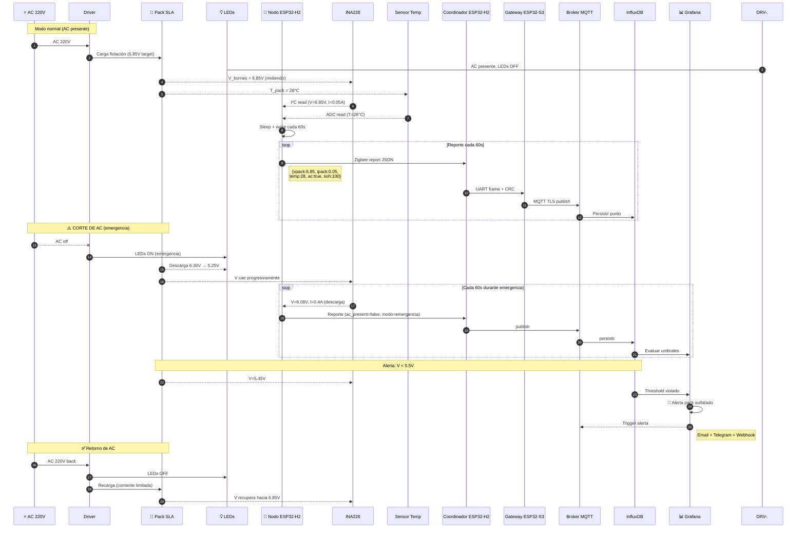
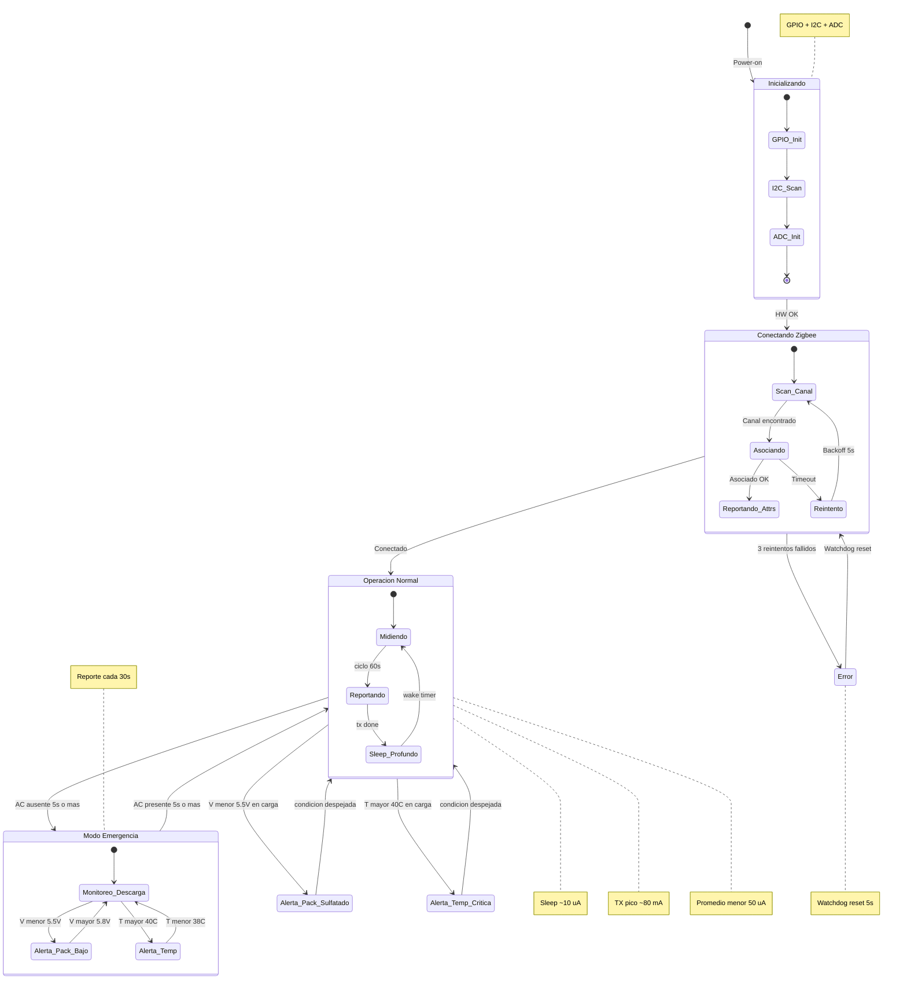
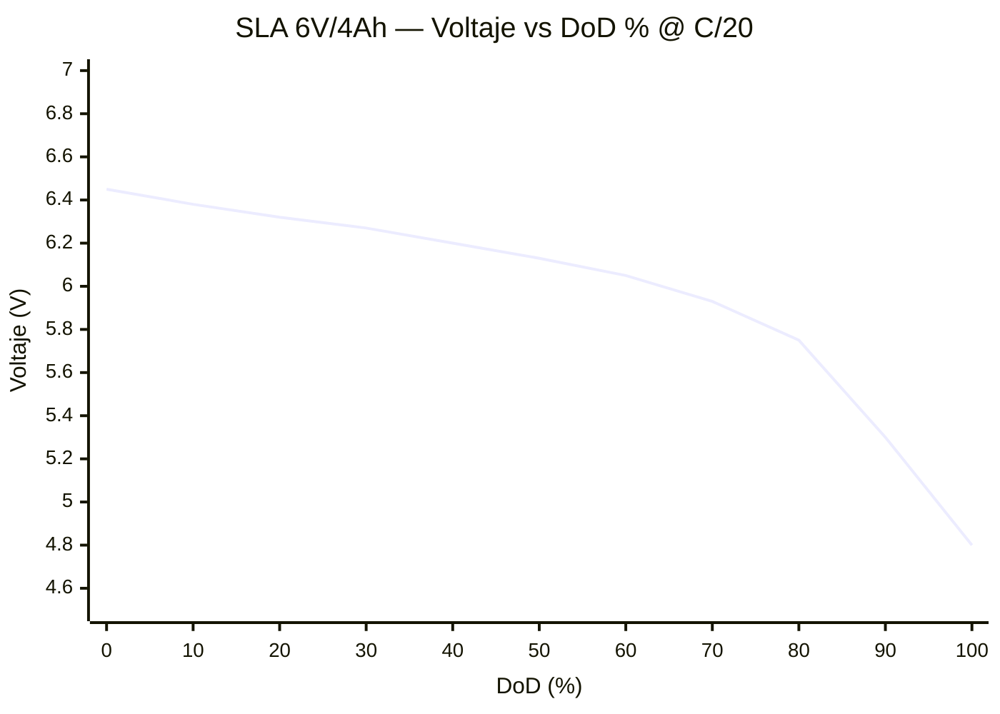

# Lámpara de Emergencia IoT — Plan Resumido, Diagramas & Curva de Descarga SLA

> **Tag:** `#proyectos/luces-emergencia` `#obsidian` `#diagramas`  
> **Origen:** sesión de trabajo con Simón el 2026-08-11  
> **Estado:** Fase 0 — decisiones de arquitectura  
> **Stack objetivo:** ESP32-H2 + coordinador H2 + ESP32-S3 Wi-Fi/MQTT + InfluxDB + Grafana

---

## 1. Resumen Ejecutivo del Proyecto

Diseño de un **dongle interno de telemetría** para luminarias de emergencia Opalux 9101-4SMD en Perú. El dongle se conecta al **pack de batería** dentro de la lámpara (sin violar garantía, ver §3) y reporta por **Zigbee 3.0** a un coordinador H2. Un ESP32-S3 recibe las tramas por UART, agrega conectividad Wi-Fi y publica a **MQTT TLS → InfluxDB → Grafana**.

**Caso de uso:** cumplimiento ITSE automatizado, mantenimiento predictivo, dashboard en tiempo real.

**Diferenciador clave:** el dispositivo IoT monitorea variables de batería (V, I, T, SoH) que el sensor AC no puede capturar.

**MVP:** piloto de 1–3 unidades; escalamiento posterior hasta 50 unidades en un local real.

---

## 2. Hardware Confirmado (de fotos reales)

| Componente | Spec | Fuente |
|---|---|---|
| Lámpara | Opalux 9101-4SMD (Slim, 2400 lm) | Caja + tarjeta |
| Batería | **OPALUX DH640** — 6V / 4.0Ah SLA sellada (AGM, standby use) | Foto batería |
| S/N batería | `20251010` → fabricación 2025-10-10 (~10 meses, fresca) | Etiqueta |
| Certificaciones | UL, CE, ISO 9001 | Etiqueta |
| **Límite térmico fabricante** | **40°C** (advertencia en etiqueta) | Foto batería |
| Conector pack ↔ driver | **Faston hembra 4.8mm** (serie 187) | Foto conector |
| Layout interno | Compartimento inferior con ~35×30 mm libres | Foto panorámica |
| Fusible pack | Vidrio en serie con pack (preservar) | Foto panorámica |

---

## 3. Estado del Proyecto — Decisiones de Arquitectura (Fase 0)

| #   | Decisión                                     | Estado              | Recomendación Simón                                            |
| --- | -------------------------------------------- | ------------------- | -------------------------------------------------------------- |
| 1   | Alimentación dongle                          | 🟡 **Pendiente OK** | **Dual** (pack + driver con OR-ing Schottky) → telemetría 24/7 |
| 2   | MCU                                          | ✅ Resuelto          | **ESP32-H2-WROOM-03-H2** (nodo Zigbee; 3 unidades en stock)    |
| 3   | Coordinador                                  | ✅ Resuelto          | **ESP32-H2 adicional** conectado por UART al ESP32-S3          |
| 4   | Gateway Wi-Fi                                | ✅ Resuelto          | **ESP32-S3** como puente UART→Wi-Fi→MQTT                       |
| 5   | Voltaje pack = **6V SLA**                    | ✅ Resuelto          | —                                                              |
| 6   | Conector = **faston H 4.8mm + adaptador FF** | ✅ Resuelto          | —                                                              |
| 7   | Firmware                                     | 🟡 **Pendiente OK** | **ESP-IDF puro** (sin Arduino)                                 |
| 8   | Datos en reposo                              | 🟡 **Pendiente OK** | **On-prem piloto, híbrido producción**                         |

### Mediciones reales del pack (multímetro)

| Medición | Valor | Referencia SLA 6V | Diagnóstico |
|---|---|---|---|
| `V_open` (AC off, sin carga) | **6.36 V** | 6.3 – 6.4 V (100% SoC) | ✅ Pack sano |
| `V_descargando` (LEDs on, modo emergencia) | **6.08 V** | 6.0 – 6.3 V (descarga en curso) | ✅ Pack entrega corriente bien |
| Caída bajo carga | **0.28 V** | < 0.5 V (pack sano) | ✅ Resistencia interna OK |

**Conclusión:** el pack DH640 está en **excelente estado**, no sulfatado, listo para integrar el dongle.

### 3.1 Gateway del MVP

El gateway no usará LuckFox ni Sonoff en la primera versión. Se compondrá de un **ESP32-H2 coordinador** y un **ESP32-S3** disponible en el stock propio de Maykol:

`ESP32-H2 coordinador → UART 3.3V → ESP32-S3 → Wi-Fi → MQTT TLS → Kuska-IoT`

El LuckFox Pico Pro queda como alternativa para una futura versión Linux o gateway con almacenamiento y servicios locales. La implementación del coordinador H2 y el protocolo UART deben validarse primero con un enlace de laboratorio.

---

## 4. Diagramas Mermaid (nativos en Obsidian)

> 📌 Los bloques `mermaid` se renderizan automáticamente en Obsidian (plugin nativo).  
> Para exportar a PNG/SVG: clic derecho → "Export to PNG" / "Export to SVG".

### 4.1 Diagrama Funcional — Arquitectura del Sistema



### 4.2 Diagrama de Secuencia — Operación Normal + Emergencia



### 4.3 Diagrama de Estados — Lifecycle del Dongle




## 5. Voltaje Mínimo Permitido — Análisis Detallado

### 5.1 Umbrales para SLA 6V (estándar industria)

| Umbral | Voltaje | Significado | Acción firmware |
|---|---|---|---|
| **Nominal** | **6.00 V** | Voltaje de diseño (100% SoC ≈ 6.30 V) | Referencia |
| 🟡 **Alerta temprana** | **5.85 V** | Pack entrando en zona de atención (≈70% DoD) | Aumentar frecuencia reporte |
| 🔴 **Pack sulfatado** | **< 5.50 V** | En carga sostenida, no llega a flotación | Alerta crítica inmediata |
| 🛑 **Cutoff firme** | **5.25 V** | 1.75 V/celda × 3 celdas — **mínimo absoluto permitido** | Desconectar carga / apagar dongle |
| 💀 **Daño permanente** | **< 5.00 V** | Sulfatación irreversible; pérdida de capacidad progresiva | Pack debe reemplazarse |
| ☠️ **Inversión de polaridad** | **< 3.00 V** | Una o más celdas se invierten → **pack muerto** | Reemplazo obligatorio |

### 5.2 Conceptos clave

- **Cutoff voltage (5.25 V para SLA 6V):** tensión a la que se debe interrumpir la descarga para preservar la vida útil. Por debajo de este valor, la reacción química se vuelve destructiva.
- **Sulfatación:** formación de cristales de sulfato de plomo en las placas. Es **progresiva** — empieza a voltajes bajos sostenidos y se vuelve **irreversible** si el pack permanece descargado por días.
- **Inversión de celda:** si una celda se descarga mucho más que las otras, su polaridad se invierte → **daño permanente inmediato**.
- **Regla práctica:** *nunca* dejar un pack SLA por debajo de 5.25 V sin recargar inmediatamente.

### 5.3 Implicación para el firmware

El dongle debe implementar **protección de bajo voltaje** (UVLO):

```c
// Pseudo-código del firmware (ESP-IDF)
#define V_CUTOFF          5.25f  // Apagar carga / entrar a sleep profundo
#define V_ALERTA          5.50f  // Alerta pack sulfatado
#define V_ATENCION        5.85f  // Aumentar frecuencia de reporte
#define V_REPOSO_100PCT   6.30f  // Pack sano a 100% SoC
```

**Acción del firmware en cada caso:**

| V medida | Estado | Acción |
|---|---|---|
| ≥ 6.30 V | Normal | Reporte cada 60 s |
| 5.85 – 6.30 V | Normal (descargando) | Reporte cada 60 s |
| 5.50 – 5.85 V | Atención | Reporte cada 30 s + log warning |
| < 5.50 V en carga | 🔴 Alerta | Reporte cada 10 s + alerta MQTT |
| < 5.25 V | 🛑 UVLO | Sleep profundo, solo wake para medir |

---

## 6. Curva de Descarga Típica — SLA 6V/4Ah @ C/20 (0.2A)

### 6.1 Visualización SVG (renderiza inline en Obsidian)

> 📌 Si el SVG no se ve, instalar el plugin **"SVG Editor"** o abrir el archivo en un viewer externo.

```svg
<svg viewBox="0 0 720 420" xmlns="http://www.w3.org/2000/svg" font-family="system-ui, sans-serif">
  <defs>
    <linearGradient id="bg" x1="0" y1="0" x2="0" y2="1">
      <stop offset="0%" stop-color="#f8fafc"/>
      <stop offset="100%" stop-color="#e2e8f0"/>
    </linearGradient>
    <linearGradient id="zoneRed" x1="0" y1="1" x2="0" y2="0">
      <stop offset="0%" stop-color="#fee2e2" stop-opacity="0.9"/>
      <stop offset="100%" stop-color="#fee2e2" stop-opacity="0.3"/>
    </linearGradient>
    <linearGradient id="zoneYellow" x1="0" y1="1" x2="0" y2="0">
      <stop offset="0%" stop-color="#fef3c7" stop-opacity="0.7"/>
      <stop offset="100%" stop-color="#fef3c7" stop-opacity="0.2"/>
    </linearGradient>
    <linearGradient id="zoneGreen" x1="0" y1="1" x2="0" y2="0">
      <stop offset="0%" stop-color="#d1fae5" stop-opacity="0.7"/>
      <stop offset="100%" stop-color="#d1fae5" stop-opacity="0.2"/>
    </linearGradient>
  </defs>
  
  <!-- Background -->
  <rect width="720" height="420" fill="url(#bg)"/>
  
  <!-- Title -->
  <text x="360" y="25" text-anchor="middle" font-size="16" font-weight="bold" fill="#0f172a">
    Curva de descarga SLA 6V / 4Ah @ C/20 (0.2A, 25°C)
  </text>
  <text x="360" y="42" text-anchor="middle" font-size="11" fill="#64748b">
    OPALUX DH640 · Referencia: curvas típicas Yuasa / Genesis / Interstate AGM
  </text>
  
  <!-- Zonas de color -->
  <!-- Verde: 0-50% DoD (normal) -->
  <rect x="80" y="100" width="300" height="250" fill="url(#zoneGreen)"/>
  <!-- Amarillo: 50-80% DoD (atención) -->
  <rect x="380" y="100" width="180" height="250" fill="url(#zoneYellow)"/>
  <!-- Rojo: 80-100% DoD (peligro) -->
  <rect x="560" y="100" width="140" height="250" fill="url(#zoneRed)"/>
  
  <!-- Grid lines (Y axis) -->
  <g stroke="#cbd5e1" stroke-width="1" stroke-dasharray="3,3">
    <line x1="80" y1="100" x2="700" y2="100"/>
    <line x1="80" y1="160" x2="700" y2="160"/>
    <line x1="80" y1="220" x2="700" y2="220"/>
    <line x1="80" y1="280" x2="700" y2="280"/>
    <line x1="80" y1="340" x2="700" y2="340"/>
  </g>
  
  <!-- Ejes -->
  <line x1="80" y1="50" x2="80" y2="350" stroke="#0f172a" stroke-width="2"/>
  <line x1="80" y1="350" x2="700" y2="350" stroke="#0f172a" stroke-width="2"/>
  
  <!-- Etiquetas eje Y (voltajes) -->
  <g font-size="11" fill="#475569" text-anchor="end">
    <text x="72" y="104">7.0 V</text>
    <text x="72" y="164">6.5 V</text>
    <text x="72" y="224">6.0 V</text>
    <text x="72" y="284">5.5 V</text>
    <text x="72" y="344">5.0 V</text>
  </g>
  
  <!-- Etiquetas eje X (DoD %) -->
  <g font-size="11" fill="#475569" text-anchor="middle">
    <text x="80" y="368">0%</text>
    <text x="140" y="368">10%</text>
    <text x="200" y="368">20%</text>
    <text x="260" y="368">30%</text>
    <text x="320" y="368">40%</text>
    <text x="380" y="368">50%</text>
    <text x="440" y="368">60%</text>
    <text x="500" y="368">70%</text>
    <text x="560" y="368">80%</text>
    <text x="620" y="368">90%</text>
    <text x="680" y="368">100%</text>
  </g>
  
  <!-- Etiquetas de ejes -->
  <text x="40" y="200" text-anchor="middle" font-size="12" fill="#0f172a" transform="rotate(-90, 40, 200)">
    Voltaje (V)
  </text>
  <text x="390" y="395" text-anchor="middle" font-size="12" fill="#0f172a">
    Profundidad de descarga (DoD %)
  </text>
  
  <!-- Cutoff line (5.25V) -->
  <line x1="80" y1="310" x2="700" y2="310" stroke="#dc2626" stroke-width="1.5" stroke-dasharray="6,3"/>
  <text x="690" y="305" font-size="10" fill="#dc2626" text-anchor="end" font-weight="bold">
    Cutoff 5.25V
  </text>
  
  <!-- Sulfatada line (5.50V) -->
  <line x1="80" y1="280" x2="700" y2="280" stroke="#ea580c" stroke-width="1" stroke-dasharray="4,3"/>
  <text x="690" y="275" font-size="10" fill="#ea580c" text-anchor="end">
    Sulfatada 5.50V
  </text>
  
  <!-- Curva SLA (path smooth) -->
  <!-- Puntos calculados: x = 80 + DoD*6.2 ; y = 350 - (V-5.0)*120 -->
  <path d="M 80,116
           C 110,118 140,122 170,128
           C 200,132 230,134 260,138
           C 290,142 320,148 350,154
           C 380,160 410,168 440,178
           C 470,190 500,206 530,222
           C 555,238 580,260 605,290
           C 625,316 650,332 680,338"
        stroke="#1d4ed8" fill="none" stroke-width="3" stroke-linecap="round"/>
  
  <!-- Puntos clave con marcadores -->
  <g fill="#1d4ed8">
    <circle cx="80" cy="116" r="4"/>
    <circle cx="170" cy="128" r="3"/>
    <circle cx="260" cy="138" r="3"/>
    <circle cx="350" cy="154" r="3"/>
    <circle cx="440" cy="178" r="3"/>
    <circle cx="530" cy="222" r="3"/>
    <circle cx="620" cy="290" r="3"/>
    <circle cx="680" cy="338" r="4"/>
  </g>
  
  <!-- Etiquetas de zona -->
  <text x="230" y="95" text-anchor="middle" font-size="11" font-weight="bold" fill="#15803d">
    ✅ NORMAL
  </text>
  <text x="470" y="95" text-anchor="middle" font-size="11" font-weight="bold" fill="#ca8a04">
    ⚠️ ATENCIÓN
  </text>
  <text x="630" y="95" text-anchor="middle" font-size="11" font-weight="bold" fill="#dc2626">
    🔴 PELIGRO
  </text>
  
  <!-- Anotaciones en puntos clave -->
  <g font-size="9" fill="#1e293b">
    <text x="92" y="115">6.45V (inicio)</text>
    <text x="450" y="172">60% DoD</text>
    <text x="540" y="218">75% DoD (knee)</text>
    <text x="595" y="305" fill="#dc2626" font-weight="bold">5.25V cutoff</text>
    <text x="660" y="335" fill="#7f1d1d" font-weight="bold">Daño</text>
  </g>
  
  <!-- Leyenda inferior -->
  <g font-size="10" fill="#475569">
    <line x1="100" y1="412" x2="120" y2="412" stroke="#1d4ed8" stroke-width="3"/>
    <text x="125" y="415">Curva de descarga</text>
    
    <line x1="240" y1="412" x2="260" y2="412" stroke="#ea580c" stroke-width="1.5" stroke-dasharray="4,3"/>
    <text x="265" y="415">Umbral sulfatada</text>
    
    <line x1="370" y1="412" x2="390" y2="412" stroke="#dc2626" stroke-width="1.5" stroke-dasharray="6,3"/>
    <text x="395" y="415">Cutoff firme</text>
  </g>
</svg>
```

### 6.2 Datos tabulares (para plugin **Charts** o **Dataview**)

| DoD (%) | Tiempo (h @ C/20) | Voltaje (V) | Estado |
|---:|---:|---:|---|
| 0 | 0.0 | 6.45 | Nominal |
| 5 | 1.0 | 6.42 | Nominal |
| 10 | 2.0 | 6.38 | Nominal |
| 15 | 3.0 | 6.35 | Nominal |
| 20 | 4.0 | 6.32 | Nominal |
| 25 | 5.0 | 6.30 | Nominal |
| 30 | 6.0 | 6.27 | Nominal |
| 40 | 8.0 | 6.20 | Nominal |
| 50 | 10.0 | 6.13 | Normal (transición) |
| 60 | 12.0 | 6.05 | Atención |
| 70 | 14.0 | 5.93 | Atención |
| 75 | 15.0 | 5.85 | 🟡 Alerta temprana |
| 80 | 16.0 | 5.75 | 🟡 Knee curve |
| 85 | 17.0 | 5.55 | 🔴 Sulfatada |
| 90 | 18.0 | 5.30 | 🔴 Daño progresivo |
| 95 | 19.0 | 5.25 | 🛑 Cutoff firme |
| 100 | 20.0 | 4.80 | ☠️ Inversión / pack muerto |

### 6.3 Curva alternativa con Mermaid `xychart-beta` (portable)



> 💡 **Tip:** Para visualizar este xychart en Obsidian necesitas Obsidian **v1.5+**. Si tu versión es anterior, usa el SVG de §6.1.

---

## 7. Plugins de Obsidian Recomendados

| Plugin | Función | Estado | Notas |
|---|---|---|---|
| **Mermaid** (nativo) | Diagramas técnicos (flowchart, sequence, state, xychart) | ✅ Incluido | Renderiza bloques `mermaid` automáticamente |
| **Excalidraw** | Diagramas hand-drawn (arquitectura, layout PCB) | ⬇ Instalar | Excelente para bocetos rápidos de HW |
| **Charts** (by phibrid) | Gráficos interactivos con Chart.js | ⬇ Instalar | Usa la tabla de §6.2 con bloque `chart` |
| **Dataview** | Tablas dinámicas desde el vault | ⬇ Instalar | Útil para listar dongles / pack status |
| **SVG Editor** | Editar SVG inline | ⬇ Instalar | Modifica la curva de §6.1 directamente |
| **Obsidian Git** | Control de versiones del vault | ⬇ Instalar | Backup automático del proyecto |
| **Templater** | Templates dinámicos | ⬇ Instalar | Generar reportes automáticos de dongles |
| **Mind Map** | Mapas mentales | ⬇ Instalar | Lluvia de ideas de features / casos de uso |
| **Plotly** | Gráficos interactivos avanzados (3D, heatmaps) | ⬇ Opcional | Para dashboards más complejos |
| **Better PDF** | Importar/exportar PDFs | ⬇ Opcional | Compartir el plan con stakeholders |

### Snippet para plugin **Charts** (copiar-pegar en bloque `chart`):

````chart
type: line
labels:
  - 0%
  - 10%
  - 20%
  - 30%
  - 40%
  - 50%
  - 60%
  - 70%
  - 80%
  - 90%
  - 100%
series:
  - title: Voltaje (V)
    data:
      - 6.45
      - 6.38
      - 6.32
      - 6.27
      - 6.20
      - 6.13
      - 6.05
      - 5.93
      - 5.75
      - 5.30
      - 4.80
yAxis:
  min: 4.5
  max: 7.0
  title: Voltaje (V)
xAxis:
  title: DoD (%)
````

---

## 8. Próximos Pasos (Fase 0 → Fase 1 → Fase 2)

### 8.1 Inmediato (esta sesión)

- [ ] **Maykol: validar gateway propio** (ESP32-H2 coordinador / UART / ESP32-S3 Wi-Fi / MQTT TLS).
- [ ] Actualizar README del proyecto con pack DH640 + faston 4.8mm + umbrales calibrados.
- [ ] Cerrar Fase 0 formalmente.

### 8.2 Fase 1 — Compras (MCU Zigbee y gateway Wi-Fi disponibles)

| Componente | Proveedor | Precio |
|---|---|---|
| ESP32-H2-WROOM-03-H2 para nodo | Stock InvenTree | $0.00 |
| ESP32-H2 adicional para coordinador | Stock InvenTree | $0.00 |
| ESP32-S3 para gateway Wi-Fi | Stock propio de Maykol | $0.00 |
| INA226 breakout (CJMCU-INA226) | AliExpress | $2.50 |
| Shunt 50 mΩ, ≥0.25 W, 1%, baja TCR | AliExpress / LCSC | $0.30 |
| NTC 10K encapsulado | AliExpress | $0.50 |
| HLK-B03 (DC-DC 12V→3.3V) | AliExpress | $1.50 |
| MT3608 (boost 4-12V→3.3V) | AliExpress | $1.00 |
| 2× SS24 Schottky (OR-ing) | LCSC | $0.20 |
| 2× Adaptador faston FF 4.8mm | AliExpress | $0.20 |
| Cables AWG22 + dupont | Local | $2.00 |
| Caja ABS 35×30×15mm | Local | $1.00 |
| **TOTAL incremental estimado** | | **~$9.20** |

### 8.3 Fase 2 — Firmware ESP-IDF (en paralelo)

- Estructura del repo (`firmware/` en workspace del proyecto).
- Firmware H2 de lámpara: driver INA226 sobre I²C (lectura V + I + P cada 60 s).
- Firmware H2 de lámpara: driver NTC sobre ADC (lectura de temperatura con curva Beta).
- Firmware H2 de lámpara: endpoint Zigbee custom con telemetría.
- Firmware H2 coordinador: red Zigbee, recepción de reportes y reenvío por UART.
- Protocolo UART H2 coordinador↔ESP32-S3 con framing, CRC16, ACK, timeout y versionado.
- Firmware ESP-IDF en ESP32-S3 para validar tramas, convertir a JSON, almacenar buffer local y publicar MQTT TLS.
- El INA226 se usará en high-side con shunt externo de 50 mΩ. Verificar el valor real del shunt del breakout antes de conectarlo; no asumir que todos los CJMCU montan el mismo valor.
- ALERT: disponible para umbrales con el INA226 activo; en shutdown del INA226 no hay monitorización continua. Para mínimo consumo, usar conversión single-shot y despertar por RTC/GPIO según la estrategia validada.
- UVLO (under-voltage lockout) con hysteresis.
- Reporte JSON cada 60 s con: `device_id`, `vpack`, `ipack`, `power_w`, `temp_pack`, `ac_present`, `soh_pct`, `rssi`.

---

## 9. Referencias Técnicas

- **OPALUX DH640 datasheet** (etiqueta física).
- **Yuasa NP series technical manual** — curvas de referencia SLA.
- **IEEE 1188-2005** — *Recommended Practice for Maintenance, Testing, and Replacement of Valve-Regulated Lead-Acid Batteries*.
- **ESP-IDF Zigbee documentation** — documentación de Espressif para ESP32-H2/802.15.4.
- **INA226 datasheet** — Texas Instruments.
- **ESP-IDF Zigbee SDK** — Espressif; base para implementar el nodo y el coordinador H2.
- **Base legal luces de emergencia Perú** — `investigaciones/2026-08-09-base-legal-luces-emergencia-peru.md`.

---

## 10. Tags y Links Internos (para Dataview)

```yaml
tags: [proyectos/luces-emergencia, hardware/esp32-h2, hardware/esp32-s3, hardware/sla-6v, firmware/esp-idf, obsidian/diagramas]
proyecto: luces-emergencia-iot
fase: 0
estado: decisiones-pendientes
created: 2026-08-11
updated: 2026-08-13
hardware: [opla-9101-4smd, opalux-dh640, esp32-h2-wroom-03-h2, esp32-s3-gateway, ina226, ntc10k]
```

> 💡 **Tip Dataview:** crea un dashboard en tu vault con bloque `dataview` para listar automáticamente todos los proyectos y su estado.

---

*Documento actualizado por Simón el 2026-08-13. Optimizado para Obsidian con plugins Mermaid + Excalidraw + Charts + SVG Editor.*
