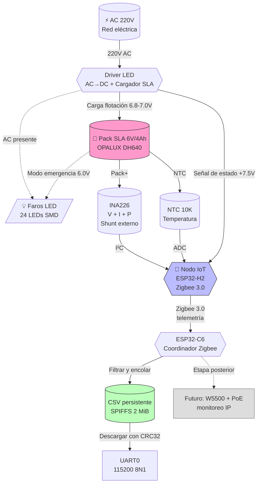
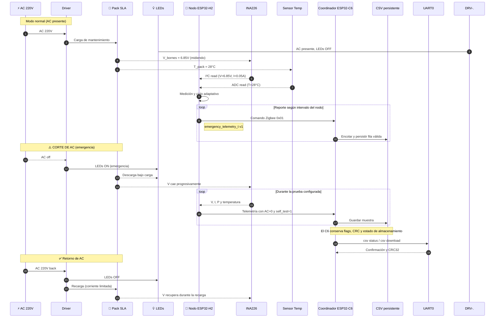
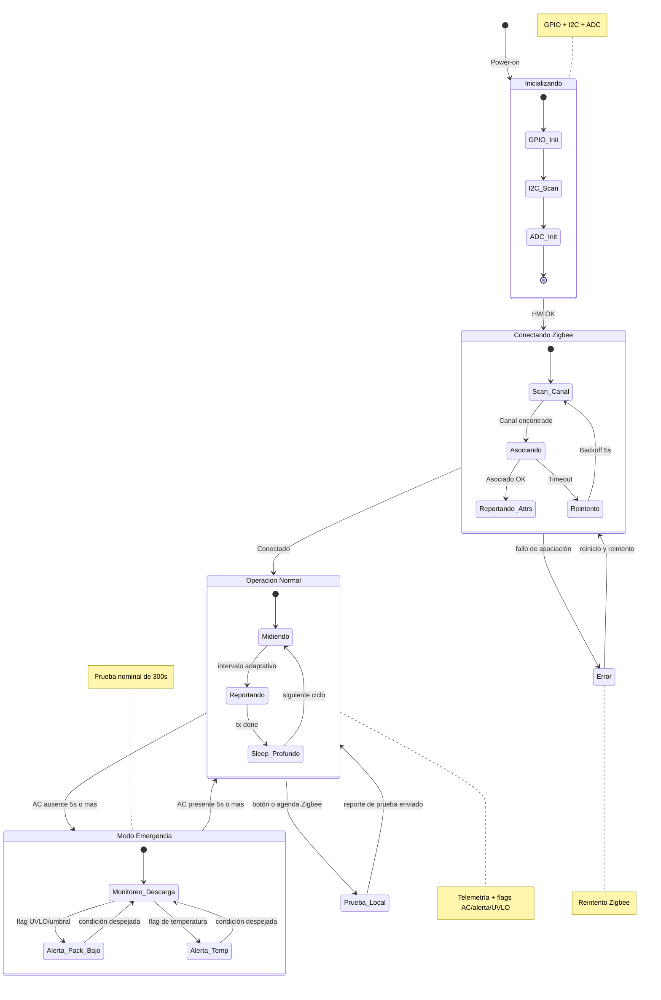
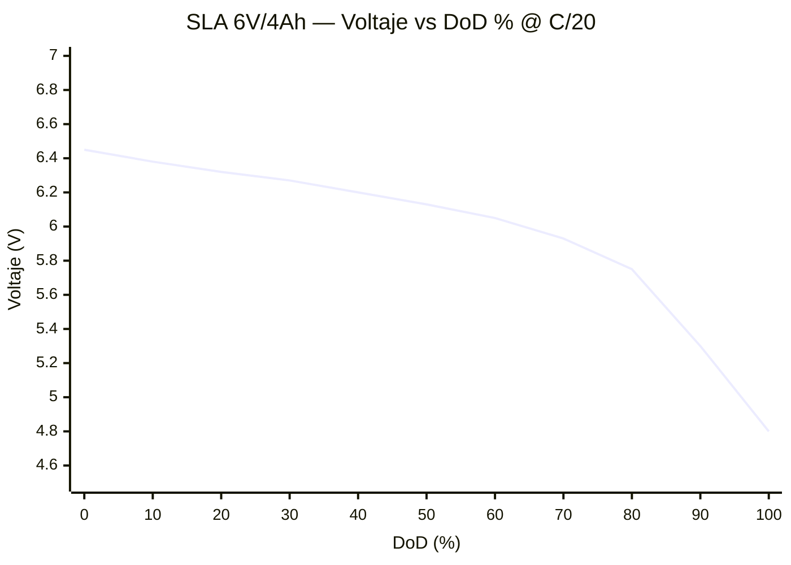

# Lámpara de Emergencia IoT — Alcance, Arquitectura & Curva de Descarga SLA

> **Tag:** `#proyectos/luces-emergencia` `#obsidian` `#diagramas`  
> **Origen:** sesión de trabajo con Simón el 2026-08-11  
> **Estado:** Fase 1 — prototipo de hardware y firmware validado en banco; cierre de PCBs pendiente
> **Alcance actual:** nodo ESP32-H2 + gateway coordinador ESP32-C6 + telemetría Zigbee/CSV persistente
> **Ruta futura:** gateway ESP32-C6 con Ethernet W5500 y PoE; integración de monitoreo aún no implementada

---

## 1. Resumen Ejecutivo del Proyecto

Diseño de un **nodo interno de telemetría** para luminarias de emergencia Opalux 9101-4SMD en Perú. El nodo se conecta al **pack de batería** dentro de la lámpara y reporta por **Zigbee 3.0** a un gateway basado en ESP32-C6. El gateway registra la telemetría validada en un CSV persistente de la flash y permite descargarla por UART para análisis.

**Caso de uso:** instrumentación de pruebas de batería, diagnóstico de luminarias y base para mantenimiento predictivo. El dashboard, las alertas remotas y la integración con plataformas externas quedan fuera del MVP actual.

**Diferenciador clave:** el dispositivo IoT monitorea variables de batería (V, I, T, SoH) que el sensor AC no puede capturar.

**MVP actual:** una o más luminarias H2 conectadas a un C6 coordinador, con telemetría Zigbee, pruebas de descarga y almacenamiento CSV. El firmware del C6 contempla hasta 50 nodos y grupos de prueba de hasta 10 luminarias.

### Estado actual y límites del alcance

El proyecto ya no está en la fase de decisiones iniciales. El trabajo se organiza ahora en tres entregables relacionados:

1. **PCB de la lámpara:** nodo ESP32-H2-MINI-1, medición INA226, NTC, detección de presencia de alimentación del controlador, relé de prueba y botón local.
2. **Firmware de campo y gateway de laboratorio:** `h2-emergency-light` como nodo Zigbee y `c6-zigbee-gateway` como coordinador, receptor y registrador CSV.
3. **Gateway de producción en desarrollo:** PCB ESP32-C6 + W5500 + PoE. Es una segunda placa y todavía no forma parte de una liberación de fabricación.

El camino `h2-coordinator` + `s3-gateway` + Wi-Fi/MQTT se conserva en el repositorio como alternativa experimental, pero no es la arquitectura de aceptación del MVP vigente. InfluxDB, Grafana, MQTT, SNMP y la operación de una flota en producción son etapas posteriores.

---

## 2. Hardware Confirmado (de fotos reales)

| Componente | Spec | Fuente |
|---|---|---|
| Lámpara | Opalux 9101-4SMD (Slim, 2400 lm) | Caja + tarjeta |
| Batería | **OPALUX DH640** — 6V / 4.0Ah SLA sellada (AGM, standby use) | Foto batería |
| S/N batería | `20251010` → fabricación 2025-10-10 (~10 meses, fresca) | Etiqueta |
| Certificaciones | UL, CE, ISO 9001 | Etiqueta |
| **Límite térmico fabricante** | **40°C** (advertencia en etiqueta) | Foto batería |
| Conector pack ↔ driver | **Faston hembra 4.8mm** (serie 187) | Foto conector |
| Layout interno | Compartimento inferior con ~35×30 mm libres | Foto panorámica |
| Fusible pack | Vidrio en serie con pack (preservar) | Foto panorámica |

---

## 3. Estado del Proyecto — Alcance vigente (Fase 1)

| # | Decisión / entregable | Estado actual | Alcance confirmado |
| --- | --- | --- | --- |
| 1 | Nodo de lámpara | ✅ Implementado | ESP32-H2-MINI-1 en la PCB de la lámpara; INA226, NTC, estado AC y relé de prueba. |
| 2 | Red de campo | ✅ Implementado | Zigbee 3.0, perfil HA `0x0104`, endpoint 1 y clúster privado `0xFC00`. |
| 3 | Gateway de laboratorio | ✅ Validado en banco | ESP32-C6 coordinador; recibe telemetría, registra CSV en SPIFFS y descarga por UART0. |
| 4 | Pruebas de batería | ✅ Validado en banco | Ensayo de 300 s con reporte de muestras, tensión, corriente, potencia, temperatura y flags. Campañas automáticas cerradas por defecto. |
| 5 | Gateway PoE/Ethernet | 🟡 En desarrollo | PCB separada con C6, W5500 y Si3402B. No liberar para fabricación hasta cerrar los hallazgos P0/P1 de su revisión. |
| 6 | Wi-Fi/MQTT/InfluxDB/Grafana | ⏸ Diferido | Se mantiene como alternativa futura; no es requisito para validar el MVP actual. |
| 7 | Firmware | ✅ En implementación activa | ESP-IDF v5.5; proyectos independientes y protocolo compartido en `firmware/common`. |
| 8 | Fabricación | 🟡 Pendiente de cierre | La PCB de la lámpara necesita sincronización final/paridad y revisión de liberación; la PCB gateway requiere correcciones eléctricas y físicas. |

### Mediciones reales del pack (multímetro)

| Medición | Valor | Referencia SLA 6V | Diagnóstico |
|---|---|---|---|
| `V_open` (AC off, sin carga) | **6.36 V** | 6.3 – 6.4 V (100% SoC) | ✅ Pack sano |
| `V_descargando` (LEDs on, modo emergencia) | **6.08 V** | 6.0 – 6.3 V (descarga en curso) | ✅ Pack entrega corriente bien |
| Caída bajo carga | **0.28 V** | < 0.5 V (pack sano) | ✅ Resistencia interna OK |

**Conclusión:** el pack DH640 está en **excelente estado**, no sulfatado, listo para integrar el dongle.

### 3.1 Gateway vigente del MVP

La arquitectura de aceptación actual es:

`PCB lámpara ESP32-H2 → Zigbee 3.0 → ESP32-C6 coordinador → CSV persistente → descarga UART0`

El C6 usa canal 15, recibe el payload compartido `emergency_telemetry_t` versión 1 y conserva las columnas de identificación del nodo, tiempo de recepción, tensión, corriente, potencia, temperatura, SoH, flags y uptime. La partición `telemetry` ocupa 2 MiB dentro de la flash de 8 MiB; el archivo se conserva al alcanzar su límite o ante un error de escritura hasta que se solicite un borrado explícito.

La validación de banco del 2026-10-23 comprobó recepción real del H2, incorporación de filas, descarga con CRC32 y conservación de cinco filas después de reiniciar el C6, sin errores de escritura ni pérdidas de cola. El ensayo del 2026-10-24 comprobó una descarga de 300 s con 61 muestras y reporte coherente de estado AC, autoprueba y CRC. Las pruebas de llenado, corte durante escritura y transferencia prolongada siguen pendientes.

La PCB futura de gateway con **ESP32-C6 + W5500 + PoE** no debe confundirse con este gateway de laboratorio. Su objetivo es sustituir la salida UART por red cableada/PoE, pero la revisión actual todavía exige corregir el pad expuesto del Si3402B, resolver la convivencia PoE/USB y cerrar problemas de entrada PoE, potencia, LEDs Ethernet, huellas y DRC.

---

## 4. Diagramas Mermaid (nativos en Obsidian)

> 📌 Los bloques `mermaid` se renderizan automáticamente en Obsidian (plugin nativo).  
> Para exportar a PNG/SVG: clic derecho → "Export to PNG" / "Export to SVG".
>
> Los diagramas siguientes fueron actualizados para distinguir la arquitectura
> vigente del MVP de las integraciones futuras. Las curvas y umbrales de §5–§6
> son referencias de ingeniería para el pack SLA; no sustituyen los límites y
> flags realmente definidos en el firmware.

### 4.1 Diagrama Funcional — Arquitectura del Sistema



### 4.2 Diagrama de Secuencia — Operación, prueba y registro vigente



### 4.3 Diagrama de Estados — Lifecycle del nodo y registro




## 5. Voltaje Mínimo Permitido — Análisis Detallado

### 5.1 Umbrales para SLA 6V (estándar industria)

| Umbral | Voltaje | Significado | Acción firmware |
|---|---|---|---|
| **Nominal** | **6.00 V** | Voltaje de diseño (100% SoC ≈ 6.30 V) | Referencia |
| 🟡 **Alerta temprana** | **5.85 V** | Pack entrando en zona de atención (≈70% DoD) | Aumentar frecuencia reporte |
| 🔴 **Pack sulfatado** | **< 5.50 V** | En carga sostenida, no llega a flotación | Alerta crítica inmediata |
| 🛑 **Cutoff firme** | **5.25 V** | 1.75 V/celda × 3 celdas — **mínimo absoluto permitido** | Desconectar carga / apagar dongle |
| 💀 **Daño permanente** | **< 5.00 V** | Sulfatación irreversible; pérdida de capacidad progresiva | Pack debe reemplazarse |
| ☠️ **Inversión de polaridad** | **< 3.00 V** | Una o más celdas se invierten → **pack muerto** | Reemplazo obligatorio |

### 5.2 Conceptos clave

- **Cutoff voltage (5.25 V para SLA 6V):** tensión a la que se debe interrumpir la descarga para preservar la vida útil. Por debajo de este valor, la reacción química se vuelve destructiva.
- **Sulfatación:** formación de cristales de sulfato de plomo en las placas. Es **progresiva** — empieza a voltajes bajos sostenidos y se vuelve **irreversible** si el pack permanece descargado por días.
- **Inversión de celda:** si una celda se descarga mucho más que las otras, su polaridad se invierte → **daño permanente inmediato**.
- **Regla práctica:** *nunca* dejar un pack SLA por debajo de 5.25 V sin recargar inmediatamente.

### 5.3 Implicación para el firmware

Estos valores son la referencia de ingeniería para el pack DH640 y deben
validarse con la corriente y la carga reales de la luminaria. El firmware actual
ya los expresa como constantes del nodo H2 y como flags compartidos con el C6;
no se debe interpretar este documento como una autorización para desconectar la
carga de la lámpara desde el INA226.

```c
// Valores actuales en firmware/h2-emergency-light/main/app_config.h
#define APP_UVLO_VOLTAGE_MV       5250
#define APP_ALERT_VOLTAGE_MV      5500
#define APP_ATTENTION_VOLTAGE_MV  5850
#define APP_SOH_FULL_VOLTAGE_MV   6300
```

**Acción del firmware en cada caso:**

| V medida | Estado | Acción |
|---|---|---|
| ≥ 6.30 V | Normal | Reporte nominal cada 60 s |
| 5.85 – 6.30 V | Atención | Reporte cada 30 s |
| 5.50 – 5.85 V | Atención/descarga | Reporte cada 30 s y log de advertencia |
| < 5.50 V | 🔴 Alerta | Reporte cada 10 s y flag de alerta |
| < 5.25 V | 🛑 UVLO | Marcar flag UVLO y evaluar la prueba; la política de apagado debe validarse en hardware |

---

## 6. Curva de Descarga Típica — SLA 6V/4Ah @ C/20 (0.2A)

### 6.1 Visualización SVG (renderiza inline en Obsidian)

> 📌 Si el SVG no se ve, instalar el plugin **"SVG Editor"** o abrir el archivo en un viewer externo.

```svg
<svg viewBox="0 0 720 420" xmlns="http://www.w3.org/2000/svg" font-family="system-ui, sans-serif">
  <defs>
    <linearGradient id="bg" x1="0" y1="0" x2="0" y2="1">
      <stop offset="0%" stop-color="#f8fafc"/>
      <stop offset="100%" stop-color="#e2e8f0"/>
    </linearGradient>
    <linearGradient id="zoneRed" x1="0" y1="1" x2="0" y2="0">
      <stop offset="0%" stop-color="#fee2e2" stop-opacity="0.9"/>
      <stop offset="100%" stop-color="#fee2e2" stop-opacity="0.3"/>
    </linearGradient>
    <linearGradient id="zoneYellow" x1="0" y1="1" x2="0" y2="0">
      <stop offset="0%" stop-color="#fef3c7" stop-opacity="0.7"/>
      <stop offset="100%" stop-color="#fef3c7" stop-opacity="0.2"/>
    </linearGradient>
    <linearGradient id="zoneGreen" x1="0" y1="1" x2="0" y2="0">
      <stop offset="0%" stop-color="#d1fae5" stop-opacity="0.7"/>
      <stop offset="100%" stop-color="#d1fae5" stop-opacity="0.2"/>
    </linearGradient>
  </defs>
  
  <!-- Background -->
  <rect width="720" height="420" fill="url(#bg)"/>
  
  <!-- Title -->
  <text x="360" y="25" text-anchor="middle" font-size="16" font-weight="bold" fill="#0f172a">
    Curva de descarga SLA 6V / 4Ah @ C/20 (0.2A, 25°C)
  </text>
  <text x="360" y="42" text-anchor="middle" font-size="11" fill="#64748b">
    OPALUX DH640 · Referencia: curvas típicas Yuasa / Genesis / Interstate AGM
  </text>
  
  <!-- Zonas de color -->
  <!-- Verde: 0-50% DoD (normal) -->
  <rect x="80" y="100" width="300" height="250" fill="url(#zoneGreen)"/>
  <!-- Amarillo: 50-80% DoD (atención) -->
  <rect x="380" y="100" width="180" height="250" fill="url(#zoneYellow)"/>
  <!-- Rojo: 80-100% DoD (peligro) -->
  <rect x="560" y="100" width="140" height="250" fill="url(#zoneRed)"/>
  
  <!-- Grid lines (Y axis) -->
  <g stroke="#cbd5e1" stroke-width="1" stroke-dasharray="3,3">
    <line x1="80" y1="100" x2="700" y2="100"/>
    <line x1="80" y1="160" x2="700" y2="160"/>
    <line x1="80" y1="220" x2="700" y2="220"/>
    <line x1="80" y1="280" x2="700" y2="280"/>
    <line x1="80" y1="340" x2="700" y2="340"/>
  </g>
  
  <!-- Ejes -->
  <line x1="80" y1="50" x2="80" y2="350" stroke="#0f172a" stroke-width="2"/>
  <line x1="80" y1="350" x2="700" y2="350" stroke="#0f172a" stroke-width="2"/>
  
  <!-- Etiquetas eje Y (voltajes) -->
  <g font-size="11" fill="#475569" text-anchor="end">
    <text x="72" y="104">7.0 V</text>
    <text x="72" y="164">6.5 V</text>
    <text x="72" y="224">6.0 V</text>
    <text x="72" y="284">5.5 V</text>
    <text x="72" y="344">5.0 V</text>
  </g>
  
  <!-- Etiquetas eje X (DoD %) -->
  <g font-size="11" fill="#475569" text-anchor="middle">
    <text x="80" y="368">0%</text>
    <text x="140" y="368">10%</text>
    <text x="200" y="368">20%</text>
    <text x="260" y="368">30%</text>
    <text x="320" y="368">40%</text>
    <text x="380" y="368">50%</text>
    <text x="440" y="368">60%</text>
    <text x="500" y="368">70%</text>
    <text x="560" y="368">80%</text>
    <text x="620" y="368">90%</text>
    <text x="680" y="368">100%</text>
  </g>
  
  <!-- Etiquetas de ejes -->
  <text x="40" y="200" text-anchor="middle" font-size="12" fill="#0f172a" transform="rotate(-90, 40, 200)">
    Voltaje (V)
  </text>
  <text x="390" y="395" text-anchor="middle" font-size="12" fill="#0f172a">
    Profundidad de descarga (DoD %)
  </text>
  
  <!-- Cutoff line (5.25V) -->
  <line x1="80" y1="310" x2="700" y2="310" stroke="#dc2626" stroke-width="1.5" stroke-dasharray="6,3"/>
  <text x="690" y="305" font-size="10" fill="#dc2626" text-anchor="end" font-weight="bold">
    Cutoff 5.25V
  </text>
  
  <!-- Sulfatada line (5.50V) -->
  <line x1="80" y1="280" x2="700" y2="280" stroke="#ea580c" stroke-width="1" stroke-dasharray="4,3"/>
  <text x="690" y="275" font-size="10" fill="#ea580c" text-anchor="end">
    Sulfatada 5.50V
  </text>
  
  <!-- Curva SLA (path smooth) -->
  <!-- Puntos calculados: x = 80 + DoD*6.2 ; y = 350 - (V-5.0)*120 -->
  <path d="M 80,116
           C 110,118 140,122 170,128
           C 200,132 230,134 260,138
           C 290,142 320,148 350,154
           C 380,160 410,168 440,178
           C 470,190 500,206 530,222
           C 555,238 580,260 605,290
           C 625,316 650,332 680,338"
        stroke="#1d4ed8" fill="none" stroke-width="3" stroke-linecap="round"/>
  
  <!-- Puntos clave con marcadores -->
  <g fill="#1d4ed8">
    <circle cx="80" cy="116" r="4"/>
    <circle cx="170" cy="128" r="3"/>
    <circle cx="260" cy="138" r="3"/>
    <circle cx="350" cy="154" r="3"/>
    <circle cx="440" cy="178" r="3"/>
    <circle cx="530" cy="222" r="3"/>
    <circle cx="620" cy="290" r="3"/>
    <circle cx="680" cy="338" r="4"/>
  </g>
  
  <!-- Etiquetas de zona -->
  <text x="230" y="95" text-anchor="middle" font-size="11" font-weight="bold" fill="#15803d">
    ✅ NORMAL
  </text>
  <text x="470" y="95" text-anchor="middle" font-size="11" font-weight="bold" fill="#ca8a04">
    ⚠️ ATENCIÓN
  </text>
  <text x="630" y="95" text-anchor="middle" font-size="11" font-weight="bold" fill="#dc2626">
    🔴 PELIGRO
  </text>
  
  <!-- Anotaciones en puntos clave -->
  <g font-size="9" fill="#1e293b">
    <text x="92" y="115">6.45V (inicio)</text>
    <text x="450" y="172">60% DoD</text>
    <text x="540" y="218">75% DoD (knee)</text>
    <text x="595" y="305" fill="#dc2626" font-weight="bold">5.25V cutoff</text>
    <text x="660" y="335" fill="#7f1d1d" font-weight="bold">Daño</text>
  </g>
  
  <!-- Leyenda inferior -->
  <g font-size="10" fill="#475569">
    <line x1="100" y1="412" x2="120" y2="412" stroke="#1d4ed8" stroke-width="3"/>
    <text x="125" y="415">Curva de descarga</text>
    
    <line x1="240" y1="412" x2="260" y2="412" stroke="#ea580c" stroke-width="1.5" stroke-dasharray="4,3"/>
    <text x="265" y="415">Umbral sulfatada</text>
    
    <line x1="370" y1="412" x2="390" y2="412" stroke="#dc2626" stroke-width="1.5" stroke-dasharray="6,3"/>
    <text x="395" y="415">Cutoff firme</text>
  </g>
</svg>
```

### 6.2 Datos tabulares (para plugin **Charts** o **Dataview**)

| DoD (%) | Tiempo (h @ C/20) | Voltaje (V) | Estado |
|---:|---:|---:|---|
| 0 | 0.0 | 6.45 | Nominal |
| 5 | 1.0 | 6.42 | Nominal |
| 10 | 2.0 | 6.38 | Nominal |
| 15 | 3.0 | 6.35 | Nominal |
| 20 | 4.0 | 6.32 | Nominal |
| 25 | 5.0 | 6.30 | Nominal |
| 30 | 6.0 | 6.27 | Nominal |
| 40 | 8.0 | 6.20 | Nominal |
| 50 | 10.0 | 6.13 | Normal (transición) |
| 60 | 12.0 | 6.05 | Atención |
| 70 | 14.0 | 5.93 | Atención |
| 75 | 15.0 | 5.85 | 🟡 Alerta temprana |
| 80 | 16.0 | 5.75 | 🟡 Knee curve |
| 85 | 17.0 | 5.55 | 🔴 Sulfatada |
| 90 | 18.0 | 5.30 | 🔴 Daño progresivo |
| 95 | 19.0 | 5.25 | 🛑 Cutoff firme |
| 100 | 20.0 | 4.80 | ☠️ Inversión / pack muerto |

### 6.3 Curva alternativa con Mermaid `xychart-beta` (portable)



> 💡 **Tip:** Para visualizar este xychart en Obsidian necesitas Obsidian **v1.5+**. Si tu versión es anterior, usa el SVG de §6.1.

---

## 7. Plugins de Obsidian Recomendados

| Plugin | Función | Estado | Notas |
|---|---|---|---|
| **Mermaid** (nativo) | Diagramas técnicos (flowchart, sequence, state, xychart) | ✅ Incluido | Renderiza bloques `mermaid` automáticamente |
| **Excalidraw** | Diagramas hand-drawn (arquitectura, layout PCB) | ⬇ Instalar | Excelente para bocetos rápidos de HW |
| **Charts** (by phibrid) | Gráficos interactivos con Chart.js | ⬇ Instalar | Usa la tabla de §6.2 con bloque `chart` |
| **Dataview** | Tablas dinámicas desde el vault | ⬇ Instalar | Útil para listar dongles / pack status |
| **SVG Editor** | Editar SVG inline | ⬇ Instalar | Modifica la curva de §6.1 directamente |
| **Obsidian Git** | Control de versiones del vault | ⬇ Instalar | Backup automático del proyecto |
| **Templater** | Templates dinámicos | ⬇ Instalar | Generar reportes automáticos de dongles |
| **Mind Map** | Mapas mentales | ⬇ Instalar | Lluvia de ideas de features / casos de uso |
| **Plotly** | Gráficos interactivos avanzados (3D, heatmaps) | ⬇ Opcional | Para dashboards más complejos |
| **Better PDF** | Importar/exportar PDFs | ⬇ Opcional | Compartir el plan con stakeholders |

### Snippet para plugin **Charts** (copiar-pegar en bloque `chart`):

````chart
type: line
labels:
  - 0%
  - 10%
  - 20%
  - 30%
  - 40%
  - 50%
  - 60%
  - 70%
  - 80%
  - 90%
  - 100%
series:
  - title: Voltaje (V)
    data:
      - 6.45
      - 6.38
      - 6.32
      - 6.27
      - 6.20
      - 6.13
      - 6.05
      - 5.93
      - 5.75
      - 5.30
      - 4.80
yAxis:
  min: 4.5
  max: 7.0
  title: Voltaje (V)
xAxis:
  title: DoD (%)
````

---

## 8. Próximos pasos y criterios de cierre

### 8.1 Trabajo completado

- [x] Definir la PCB de la lámpara alrededor del ESP32-H2-MINI-1, INA226,
  NTC, relé de prueba, botón y detección de estado de alimentación.
- [x] Implementar el nodo H2 en ESP-IDF v5.5 con medición, SoH, flags,
  pruebas locales/programadas, NVS y endpoint Zigbee privado.
- [x] Implementar el coordinador C6, registro de nodos, recepción Zigbee,
  campañas configurables y telemetría CSV persistente.
- [x] Validar en banco recepción H2→C6, descarga UART con CRC32 y persistencia
  después de reinicio.
- [x] Documentar la PCB de la lámpara, su pinout, conectores y renders de
  referencia. El soporte mecánico tiene un modelo FreeCAD y un STEP en
  `mechanical/`.

### 8.2 Cierre inmediato de la PCB de la lámpara

- [ ] Actualizar el PCB desde el esquema y eliminar la única diferencia de
  paridad pendiente relacionada con `U1.VBAT`/`+3V3`.
- [ ] Verificar en la netlist y con la hoja de datos la correspondencia física
  de Q1/BSS138LT1G, K1 y D1; confirmar que K1 conmuta la señal de baja tensión
  `+7.5V` del controlador y nunca red de 220 VAC.
- [ ] Repetir ERC y DRC con `--schematic-parity`, revisar las excepciones
  intencionales del borde de U1 y comprobar nuevamente serigrafía, antena,
  conectores, rutas Kelvin de R5 e integración mecánica.
- [ ] Cerrar la BOM con los campos `Part #`, fabricante, precio, descripción y
  LCSC; conservar la distinción entre el número de parte del fabricante/proveedor
  de InvenTree y el SKU de compra.
- [ ] Solo después de lo anterior generar los archivos de fabricación de la
  PCB de la lámpara.

### 8.3 Cierre de la PCB gateway PoE/Ethernet

- [ ] Corregir el pad expuesto de U5/Si3402B y conectarlo según la hoja de datos.
- [ ] Resolver la arquitectura de alimentación PoE/USB, retorno común,
  protección contra corriente inversa y aislamiento requerido.
- [ ] Corregir la entrada del conector PoE, potencia de R24, margen de C29,
  huellas de FB6/C34/C35/C31, estabilidad del regulador y polaridad/aislamiento
  de los LEDs del W5500.
- [ ] Repetir ERC/DRC, validar los 43 elementos sin conectar y comprobar el
  conector HY931147C, el cristal, L1 y los conectores con muestras o impresión
  1:1 antes de fabricar.

### 8.4 Validación de firmware y producto

- [ ] Ejecutar builds desde cada proyecto ESP-IDF afectado y mantener alineados
  `firmware/common/include/emergency_protocol.h` y `firmware/PROTOCOL.md`.
- [ ] Completar pruebas de llenado del CSV, borrado confirmado, corte durante
  escritura y transferencia prolongada con telemetría simultánea.
- [ ] Medir consumo, alcance Zigbee, temperatura y comportamiento del pack en
  la luminaria ensamblada; la autonomía y los umbrales finales no se deben
  inferir únicamente de la curva SLA de este documento.
- [ ] Diseñar la integración privada con monitoreo IP (W5500/PoE, MQTT, SNMP o
  servicio equivalente) después de cerrar el gateway físico y sus pruebas.

---

## 9. Referencias Técnicas

- **OPALUX DH640 datasheet** (etiqueta física).
- **Yuasa NP series technical manual** — curvas de referencia SLA.
- **IEEE 1188-2005** — *Recommended Practice for Maintenance, Testing, and Replacement of Valve-Regulated Lead-Acid Batteries*.
- **ESP-IDF Zigbee documentation** — documentación de Espressif para ESP32-H2/ESP32-C6/802.15.4.
- **INA226 datasheet** — Texas Instruments.
- **ESP-IDF Zigbee SDK** — Espressif; base para implementar el nodo H2 y el coordinador C6.
- **Base legal luces de emergencia Perú** — `investigaciones/2026-08-09-base-legal-luces-emergencia-peru.md`.

---

## 10. Tags y Links Internos (para Dataview)

```yaml
tags: [proyectos/luces-emergencia, hardware/esp32-h2, hardware/esp32-c6, hardware/w5500, hardware/poe, hardware/sla-6v, firmware/esp-idf, obsidian/diagramas]
proyecto: luces-emergencia-iot
fase: 1
estado: prototipo-banco-validado; pcbs-pendientes-de-cierre
created: 2026-08-11
updated: 2026-11-08
hardware: [opla-9101-4smd, opalux-dh640, esp32-h2-mini-1, esp32-c6, ina226, ntc10k, r5-2mohm, songle-srd-05vdc-sl-c, w5500, si3402b]
```

> 💡 **Tip Dataview:** crea un dashboard en tu vault con bloque `dataview` para listar automáticamente todos los proyectos y su estado.

---

*Documento actualizado por Simón el 2026-11-08. Optimizado para Obsidian con plugins Mermaid + Excalidraw + Charts + SVG Editor.*
