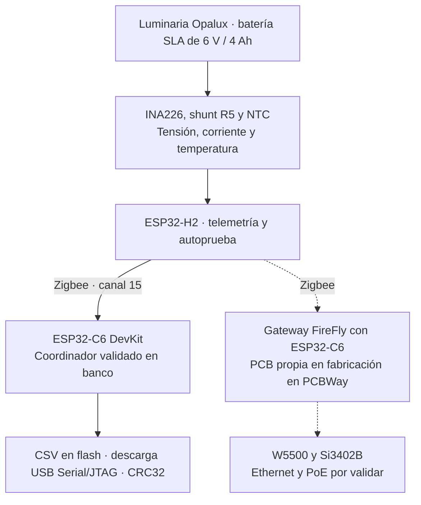
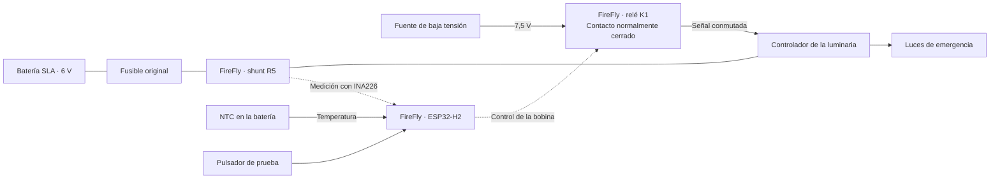
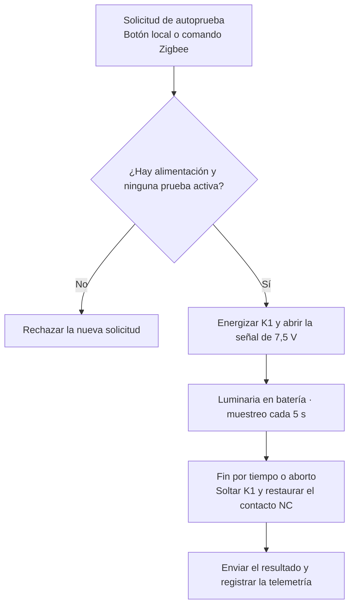
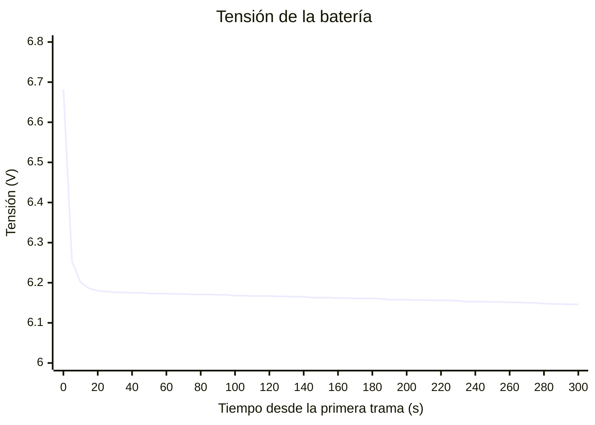
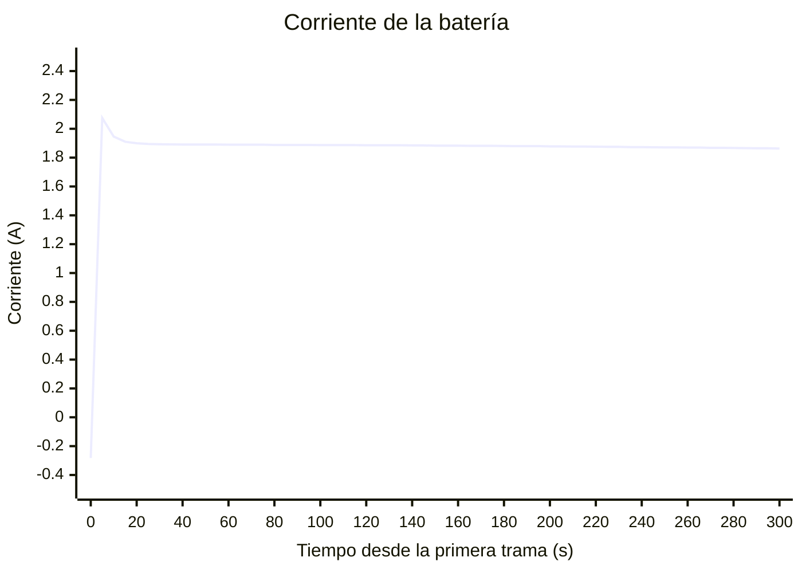
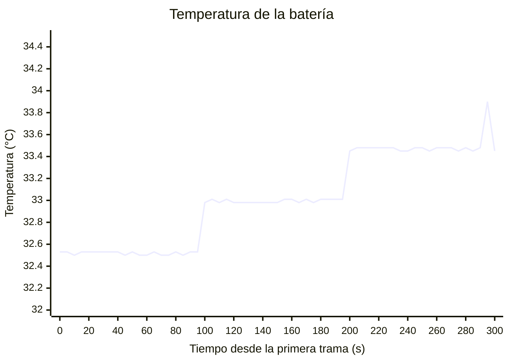

# FireFly · ¿Cómo saber si una luz de emergencia responderá al próximo corte?

*Una luminaria Opalux, dos diseños de PCB y una red Zigbee para medir la batería bajo carga. Estado del prototipo al 10 de noviembre de 2026.*

*Figura 1. Render del nodo FireFly v1.0.0. El módulo de radio queda en el borde y el relé azul conmuta la señal de baja tensión del controlador.*

Una luminaria puede tener alimentación y aun así quedarse sin autonomía cuando se corta la red. FireFly instrumenta esa situación. Mide la tensión, la corriente y la temperatura de la batería, hace funcionar la luminaria en modo de emergencia durante un intervalo controlado y deja un registro para comparar un ensayo con el siguiente. El objetivo es orientar el mantenimiento hacia las unidades que muestran una caída anormal de tensión, corriente insuficiente o cambios térmicos.

El caso de estudio es la **Opalux 9101-4SMD**, equipada con una batería sellada de plomo-ácido AGM **DH640 de 6 V y 4 Ah**. Se aprovechan los LED, el cargador, el controlador y el fusible de la luminaria. La adaptación a otro modelo exige identificar su señal de control, topología de batería, corriente y espacio disponibles. El prototipo complementa las inspecciones de funcionamiento y las pruebas de autonomía de la instalación. [Bitácora y alcance del proyecto](README.md)

## Del sensor al registro

*Figura 2. El ESP32-H2 va en la luminaria. El ESP32-C6 coordina la red Zigbee en las dos etapas del proyecto.*

| Etapa | Hardware y salida | Estado |
| --- | --- | --- |
| **Coordinador de banco** | ESP32-C6 DevKit. Guarda la telemetría en un CSV en flash y permite descargarlo por USB Serial/JTAG. | Recepción, descarga con CRC32 y persistencia tras reinicio documentadas en banco. |
| **Gateway FireFly v1.0.0** | PCB propia con ESP32-C6-WROOM-1-N8, W5500 para Ethernet y Si3402B para PoE. | El primer lote de cinco placas está en fabricación en **PCBWay**. Quedan el montaje, el encendido en banco y la validación de Ethernet y PoE. |

El H2 envía identificador, secuencia, tensión, corriente, potencia, temperatura, tiempo desde el arranque y banderas de alimentación, validez y autoprueba. El campo SoH del firmware es un indicador calculado a partir de tensión y estado de alimentación. La capacidad efectiva en Ah requiere un ensayo de descarga controlado. El C6 DevKit añade el tiempo de recepción relativo a su arranque y guarda las filas en una partición de **2 MiB**. La consola y la descarga usan **USB Serial/JTAG nativo**, normalmente `/dev/ttyACM0` en Linux. [Firmware](../firmware/README.md) · [Protocolo](../firmware/PROTOCOL.md) · [Consola y registro del C6](../firmware/c6-zigbee-gateway/README.md)

Cada luminaria evita requerir una asociación propia al Wi-Fi del edificio. Zigbee comparte la banda de 2,4 GHz con otras tecnologías y la cobertura depende del montaje, el entorno y las rutas disponibles. El H2 actual se inicializa como **router**, capaz de reenviar tráfico cuando está energizado y unido a la red. Los dispositivos finales Zigbee dependen de un padre y no retransmiten. El C6 usa el canal 15, perfil HA `0x0104`, endpoint 1 y clúster privado `0xFC00`. Hasta **50 nodos registrados** y **10 luminarias por grupo de prueba** son límites de configuración. La operación documentada con dos luminarias en banco y una autoprueba de 300 segundos son hitos de validación de menor escala. [Implementación del nodo Zigbee](../firmware/h2-emergency-light/main/zigbee_node.c) · [Configuración y pruebas del coordinador](../firmware/c6-zigbee-gateway/README.md)

## Qué hace cada placa

### Nodo FireFly de la luminaria

La placa de dos capas mide **37 × 40 mm**. El **ESP32-H2-MINI-1** lee el INA226 por I²C y la NTC de 10 kΩ por ADC. El **INA226** mide la tensión del pack y la caída en el shunt **R5 de 2 mΩ**, con la que obtiene corriente y potencia. La entrada de **7,5 V** alimenta reguladores locales de **3,3 V** para la lógica y **5 V** para la bobina. El divisor R9/R10 y el buffer U5 traducen la señal conmutada a un nivel lógico para GPIO10. [Descripción y conectores de la PCB](../emergency-light-pcb/README.md) · [Configuración del H2](../firmware/h2-emergency-light/main/app_config.h)

*Figura 3. Fotografía del prototipo durante la integración de banco.* [Vista superior renderizada](../emergency-light-pcb/docs/2026-11-10_10-54.jpg) · [Detalle renderizado del módulo H2](../emergency-light-pcb/docs/2026-11-10_11-00.jpg) · [Vistas 3D de KiCad](../emergency-light-pcb/README.md#vista-3d)

*Figura 4. Esquema conceptual del montaje. El pinout se verifica con la netlist y la PCB de la revisión que se monta.* [Ilustración original del montaje](../emergency-light-pcb/docs/2026-11-10_11-06.jpg) · [Diagrama de conexión original](svg/grafico_conexion.svg) · [Ilustración del relé](../emergency-light-pcb/docs/rele.svg)

*Figura 5. Vista del soporte extraída del archivo FreeCAD. Verificar separación, fijaciones y zona libre de antena en la carcasa antes de replicarlo.* [Modelo editable](../mechanical/emergency-light-pcb.FCStd)

### Del C6 DevKit a la PCB FireFly del gateway

El **ESP32-C6 DevKit** es el coordinador usado para validar el enlace Zigbee, las autopruebas y el registro CSV. La **PCB propia del gateway**, cuyo primer lote de placas desnudas se está fabricando en PCBWay, conserva el ESP32-C6 como coordinador e incorpora Ethernet y PoE en la misma placa.

*Figura 6. Render frontal de la PCB del gateway v1.0.0, de dos capas y 80 × 53 mm según la orden de fabricación.* [Render posterior](img/gateway-reverso.png)

El **ESP32-C6-WROOM-1-N8** mantiene el enlace Zigbee, el **W5500** comunica por Ethernet de 10/100 Mb/s y el **Si3402B** recibe alimentación desde el puerto PoE. La ventaja prevista es llevar datos y alimentación al gateway por un único cable. El USB se reserva para programación y diagnóstico, con PoE normalmente desconectado durante el servicio. En el esquema actual, Q1 es un **DMG2305UX-7** entre VBUS y +5 V, y el pad 21 del Si3402B figura en GNDA junto a VNEG. Esas conexiones deben verificarse en hardware: hay que medir posible retroalimentación hacia USB, validar el arranque con cada fuente y comprobar el enlace y los LED con el RJ45 exacto de la BOM. La integración con una plataforma de monitoreo IP queda para después de validar el hardware. [Diseño KiCad del gateway](../emergency-light-gateway-pcb/emergency-light-gateway-pcb.kicad_pro)

## Cómo funciona la autoprueba

*Figura 7. El contacto normalmente cerrado de K1 permite entregar al controlador su señal de 7,5 V en reposo. Al energizar la bobina, K1 abre ese camino y el controlador activa el modo batería. K1 trabaja en el lado de baja tensión del controlador.*

El botón local o el comando manual solicitan **30 s** de prueba. La duración máxima admitida por el H2 es **300 s**. El nodo verifica que exista alimentación y que no haya una prueba activa. Durante la descarga toma muestras cada **5 s**. Al terminar o abortar, suelta el relé y emite el resultado con tensión mínima, corriente, temperatura y número de muestras. El firmware usa 5,25 V, un pico de corriente de 50 mA y 40 °C como criterios del reporte al finalizar. El comportamiento de protección y recuperación debe comprobarse con la batería y el montaje definitivos. Las campañas automáticas vienen desactivadas y usan tiempo desde el arranque si se habilitan. [Lógica de autoprueba](../firmware/h2-emergency-light/main/battery_test.c) · [Configuración](../firmware/h2-emergency-light/main/app_config.h)

### Lo que midió el prototipo

*Figura 8. Extracto de `lamparas11.csv`, arranque 25 del C6. Las 61 muestras con bandera de autoprueba abarcan 299,999 s. Los gráficos muestran esas 61 muestras en intervalos de 5 s. El CSV conserva los tiempos exactos de recepción y las filas previa y posterior.* [CSV del gráfico](csv/ensayo-c6-arranque-25.csv)

Antes del ensayo, el nodo reportaba **6,638 V** y **−0,283 A** según la convención del registro. La primera trama de autoprueba aún marca alimentación presente. Cinco segundos después, la siguiente ya indica modo batería y la corriente llega a **2,075 A**. El mínimo durante la prueba fue **6,146 V** y la temperatura se mantuvo entre **32,5 y 33,9 °C**. La primera trama tras desactivar la bandera de prueba todavía muestra la carga de batería. Ese punto permite ver el desfase entre el estado lógico del ensayo y la lectura de la alimentación.

En un ensayo distinto, documentado el **24 de octubre**, el reporte H2 devolvió **PASS**, **61 muestras**, **6,173 V** de mínimo y **1,857 A** de promedio. En ese ensayo se observó el retorno de la señal de alimentación y se verificó la descarga con CRC correcto. Ambos registros permiten evaluar la respuesta durante cinco minutos. Para estimar autonomía o capacidad utilizable, hace falta medir hasta el umbral de corte bajo una carga representativa, con el pack plenamente cargado y temperatura controlada. La [curva SLA de la bitácora](README.md) es ilustrativa a **0,2 A**, una carga mucho menor que la observada en el banco. [Resultados del C6](../firmware/c6-zigbee-gateway/README.md#pruebas-automaticas)

## Cómo se arma y se verifica un prototipo

1. **Conciliar esquema, PCB y BOM.** Partir de la revisión exacta de KiCad, revisar ERC y DRC con paridad y contrastar las huellas con muestras o una impresión 1:1. Revisar en particular los conectores, el patrón del módulo H2, el relé y los componentes polarizados. Para PCBA, los Gerber, taladros, BOM y centroides deben salir de esa misma revisión, después de cerrar sus hallazgos.
2. **Montar e inspeccionar.** Revisar orientación y soldaduras de IC, diodos, condensadores y conectores. Confirmar continuidad en el camino de corriente y el sensado Kelvin de R5. Medir el COM/NC de K1 en reposo y su apertura al energizar la bobina. Verificar que GPIO10 reciba la salida de U5 y que J4.2 lleve la señal conmutada de 7,5 V. En J5.1 del nodo se exponen **7,5 V**: usar un adaptador de servicio cuyo cableado se haya comprobado pin por pin.
3. **Encender en banco e integrar el cableado.** Usar una fuente de baja tensión con límite de corriente para verificar los rieles de 3,3 V y 5 V. Con red y batería desconectadas al montar, conectar el trayecto de sensado en serie con la batería según la polaridad de J3, conservar el fusible original y fijar la NTC al pack. Confirmar la corriente con un instrumento de referencia y comprobar que el soporte deje libre la antena y que el cableado quede sujeto. Probar primero la unidad en banco fuera de servicio. Una vez integrado el gateway, verificar PoE y USB por separado antes de estudiar su convivencia.
4. **Programar el nodo y el C6 DevKit con ESP-IDF v5.5.** Ejecutar `source ~/esp/esp-idf/export.sh`. En `firmware/h2-emergency-light`, seleccionar `idf.py set-target esp32h2`. En `firmware/c6-zigbee-gateway`, seleccionar `idf.py set-target esp32c6`. En cada proyecto ejecutar `idf.py build` y programar el puerto identificado con `idf.py -p PUERTO flash monitor`. Si el H2 pertenece a otra red, revisar primero el estado NVS y respaldar los datos antes de cualquier borrado.
5. **Emparejar y probar.** Arrancar el C6 y energizar el H2 durante la ventana de emparejamiento de 180 s. Confirmar `Node joined` y la llegada de telemetría. Desde la consola USB nativa del C6, enviar `zigbee test DEVICE_ID` y comprobar el encendido de la luz, `self_test=1`, el reporte `TEST` y la restauración de la señal. Cerrar el monitor y ejecutar `python3 tools/csv_download.py --port /dev/ttyACM0 download lamparas.csv` desde el proyecto C6 con las dependencias del script instaladas. Comprobar CRC, unidades y persistencia tras un reinicio. [Firmware del H2](../firmware/h2-emergency-light/README.md) · [Guía de banco del C6](../firmware/c6-zigbee-gateway/README.md)

## Listas de materiales y revisiones

| PCB | Exportación de referencia | Componentes clave |
| --- | --- | --- |
| Luminaria | [BOM v1.0.0 · 24 líneas y 36 piezas](csv/bom-luminaria-v1.0.0.csv) | U1 ESP32-H2-MINI-1-N4, U2 INA226, R5 ROHM PMR18EZPFV2L00, Q1 BSS138LT1G, K1 Songle SRD-05VDC-SL-C y U5 NC7SZ125M5X. |
| Gateway | [BOM v1.0.0 · 50 líneas y 90 piezas](csv/bom-gateway-v1.0.0.csv) | U2 ESP32-C6-WROOM-1-N8, U4 W5500, U5 SI3402-B-GMR, J3 HY931147C, Q1 DMG2305UX-7 y L1 de 33 µH. |

Las copias conservan las exportaciones locales, incluidos los campos incompletos. Buscar por MPN del fabricante y cotejar el SKU con ese MPN antes de comprar. El campo `SPN_1_1` del gateway también contiene referencias de otros distribuidores. Para una unidad terminada, añadir NTC externa, arnés, conectores compatibles, fijaciones y, según el montaje, la luminaria, batería y red PoE.

- **Luminaria.** La exportación lista J1, J3 y J4 de **2,00 mm**, pero el esquema y la PCB actuales usan **2,54 mm**. J5 de servicio y H1 no aparecen en el CSV. U1 usa una huella identificada como `ESP32-C6-MINI-1`, que exige cotejo físico con el H2. El informe histórico de Q1 describía G-D-S invertido. El esquema actual usa **G-S-D** y la netlist muestra **1 = compuerta, 2 = fuente a GND y 3 = drenador a bobina**. El relé de la BOM actual es Songle y su contacto NC figura entre pads 1 y 4. Las referencias de pines del Finder antiguo pertenecen a otra revisión. [Esquema actual](../emergency-light-pcb/emergency-light-pcb.kicad_sch) · [Ficha del BSS138LT1G](https://www.onsemi.com/pdf/datasheet/bss138lt1-d.pdf)
- **Medición.** La netlist y el firmware actual coinciden en **SDA GPIO4 y SCL GPIO12**. Con **2 mΩ** y **100 µA/LSB**, el registro CAL es **25 600 (0x6400)**. El valor **5 120** corresponde al módulo histórico R010 de 10 mΩ. En el diseño actual J4.2 y GPIO10 están en redes distintas, con el divisor y U5 entre ellas. El pad 15 VBAT está sin conexión externa en la netlist. [Configuración actual](../firmware/h2-emergency-light/main/app_config.h) · [Mediciones históricas del módulo R010](../firmware/h2-emergency-light/doc/mediciones.md)
- **Gateway.** El diseño exportado usa J3 **HY931147C**. C21–C28 y C29 figuran a **100 V** y R24 es de **500 mW**, cambios respecto al reporte del 29 de octubre. La red SPI del esquema actual asigna CLK/MOSI/MISO/CS a GPIO **6/7/0/10**. Validar el mapeo en el firmware Ethernet. La fila agrupada de D1/D2/D4/D5 y R18 carecen de MPN/SKU en la exportación. En el esquema D1 y D5 figuran como **150060BS75000**. Completar esa identificación y las posiciones de servicio excluidas antes de cotizar. [Esquema principal](../emergency-light-gateway-pcb/emergency-light-gateway-pcb.kicad_sch) · [Hoja Ethernet](../emergency-light-gateway-pcb/ETH_W5500.kicad_sch) · [Hoja PoE](../emergency-light-gateway-pcb/Poe.kicad_sch)

La bitácora y los reportes locales de circuito, activos, componentes y gateway conservan hallazgos de revisiones anteriores. Para el estado del 10 de noviembre se ejecutaron ERC y DRC con paridad, recálculo de zonas y comprobación de pistas sobre ambos proyectos. Las dos PCB dieron **0 pads sin conectar y 0 diferencias de paridad**. En la luminaria quedaron **4 avisos DRC de serigrafía**, dos excluidos junto al borde del módulo, y **2 incidencias ERC de alimentación excluidas** en el proyecto. En el gateway aparecieron **15 hallazgos DRC**, entre ellos separación de agujeros, conexiones térmicas incompletas y discrepancia de huella del Si3402B. Su ERC arrojó **6 errores y 68 advertencias**, incluidas diferencias con bibliotecas locales. Los informes archivados en `v1.0.0` corresponden a sus propias opciones de comprobación. La validación de una placa ensamblada incluye pruebas eléctricas y funcionales adicionales.

## Presupuesto de cinco placas de cada diseño con destino a Perú

PCBWay mostró **US$5 por cinco PCB desnudas de cada diseño**, equivalente a **US$1 por placa**. La luminaria aparece como un lote patrocinado y enviado. El primer lote de la PCB propia del gateway con ESP32-C6 figura en fabricación. Son referencias históricas del precio de fabricación de placas de dos capas, 1,6 mm, con HASL sin plomo. Los importes históricos de pedido visibles eran **US$15,93** y **US$17,63**, respectivamente. Se mantienen como referencia de pedidos separados porque el listado no desglosa el flete ni los ajustes de patrocinio. [Ficha pública de la luminaria](https://www.pcbway.com/project/shareproject/FireFly_v1_0_0_5abd5860.html) · [Cotizador de PCB](https://www.pcbway.com/orderonline.aspx)

| Concepto en USD | Luminaria · 5 PCB | Gateway · 5 PCB |
| --- | ---: | ---: |
| Fabricación histórica, PCB desnuda | 5,00 | 5,00 |
| Componentes consumidos por placa | 6,55–8,48 | 16,78 parcial |
| Componentes consumidos por lote | 32,75–42,41 | 83,88 parcial |
| **PCB + componentes consumidos por lote** | **37,75–47,41** | **88,88 parcial** |
| **PCB + componentes consumidos por placa** | **7,55–9,48** | **17,78 parcial** |
| Compra de componentes para cinco, con mínimos | Por cerrar | 76,98 para las 16 líneas de catálogo con mínimo verificado. Las otras líneas se calculan aparte. |
| Montaje local | Cotizar mano de obra, plantilla y prueba | Cotizar mano de obra, plantilla y prueba |
| Montaje PCBWay | Evaluar elegibilidad del lote | Evaluar elegibilidad del lote |
| Flete y cargos a Perú | Cotizar según modalidad y destino | Cotizar según modalidad y destino |

**Cómo se calculó.** La luminaria suma `cantidad × precio` en las 24 filas, usando los extremos unitarios históricos de InvenTree y las filas con referencia LCSC. Para el gateway, el [desglose de precios por SKU](csv/precios-gateway-referencia.csv) cubre **28 de 50 líneas y 52 de 90 componentes**. Usa fichas LCSC consultadas el 10 de noviembre para 16 líneas, y precios históricos de InvenTree del 7 de noviembre para otras 12, sin mínimos comprobados para estas últimas. Para cada SKU con mínimo y múltiplo conocido, se redondeó la cantidad necesaria para cinco placas al siguiente múltiplo admitido, respetando el mínimo. Por ejemplo, el cristal Y1 requiere cinco piezas y la ficha vende en múltiplos de diez. El subtotal de consumo incluye únicamente las piezas instaladas. Los precios consultados pueden cambiar y quedan 22 líneas por valorar. [Cristal Y1 en LCSC](https://www.lcsc.com/product-detail/C41383248.html) · [W5500 en LCSC](https://www.lcsc.com/product-detail/ethernet%20ics_wiznet_w5500_C32843.html)

El subtotal de fabricación y componentes consumidos para **los dos lotes completos** es **US$126,63–136,29 parcial**. A la instalación de **cinco luminarias y un gateway** se le asignan **US$55,52–65,19 parciales** de ese costo. Los otros cuatro gateways quedan de reserva. Son valores de las placas y de los componentes valorados, antes de montaje, mínimos de compra, transporte, tributos y accesorios. La compra de piezas y el desembolso del lote completo se presupuestan por separado.

**Montaje local o PCBWay.** Con placas desnudas se paga el PCB, el pedido de componentes con sus mínimos y su flete, más la plantilla y el montaje local. Con PCBWay turnkey se paga el PCB, la adquisición de componentes, el montaje y la logística que indique la oferta. PCBWay anuncia **US$29 de servicio de montaje** para un lote elegible, sujeto a límites de componentes, uniones pasantes, abastecimiento y uso de la promoción. Con un solo lote elegible, el escenario de referencia pasa a **US$155,63–165,29 parciales** al agregar US$29 al subtotal de ambos lotes. Aún quedan el montaje del segundo, las diferencias de abastecimiento, el flete y los cargos que apliquen. El precio de PCBA se confirma con la revisión de Gerber, BOM y centroides. La comparación en Perú se cierra con flete y cargos de cada alternativa. SUNAT contempla inafectación hasta **US$200 FOB por envío** para los envíos que cumplen sus condiciones. Confirmar con la modalidad y el valor de la remesa si corresponde IGV, arancel u otros cargos del operador. [Condiciones de la promoción PCBWay](https://www.pcbway.com/blog/PCB_Assembly/How_to_Get_29_PCB_Assembly_and_Meet_the_Requirements_e334dbde.html) · [Cotizador de montaje](https://www.pcbway.com/quotesmt.aspx) · [SUNAT, envíos por courier](https://asistenteaduanero.sunat.gob.pe/envios-de-entrega-rapida-courier-fob-hasta-2000)

## Qué falta para completar FireFly

| Prioridad | Entregable | Criterio de cierre |
| --- | --- | --- |
| **P0** | Luminaria lista para replicar | BOM, esquema y PCB coinciden. Se documentan las exclusiones ERC/DRC y se verifican físicamente Q1, K1, D1, conectores y huella del H2. Las pruebas comprueban la transición a batería, la restauración del contacto NC al reiniciar o abortar y el nivel lógico en GPIO10. |
| **P0** | Gateway listo para el primer ensayo | Resolver o justificar hallazgos de agujeros, térmicos y bibliotecas. Conciliar BOM y montaje, verificar pad expuesto y entrada PoE. Demostrar rieles estables, ausencia de retroalimentación no prevista y enlace Ethernet con el mapeo SPI de la placa. |
| **P1** | Medición y autonomía reproducibles | Comparar tensión, corriente y temperatura con instrumentos de referencia. Medir consumo en reposo y durante el ensayo. Repetir el ensayo con batería cargada, carga conocida y temperatura registrada hasta el criterio de corte aprobado para la luminaria. |
| **P1** | Red y registro resistentes | Medir cobertura con la carcasa cerrada, pérdidas, reingreso y rutas con varios routers. Ensayar campañas con carga creciente. Llenar el CSV, interrumpir alimentación durante escritura y descargar mientras llega telemetría. Registrar pérdidas y confirmar que el prefijo recuperable conserva integridad. |
| **P2** | Monitoreo IP en un piloto | Confirmar la persistencia y el acceso por Ethernet. Seleccionar la integración IP y demostrar identificación de luminarias, edad de la última muestra, alertas y reporte de autoprueba desde el sistema de monitoreo. |
