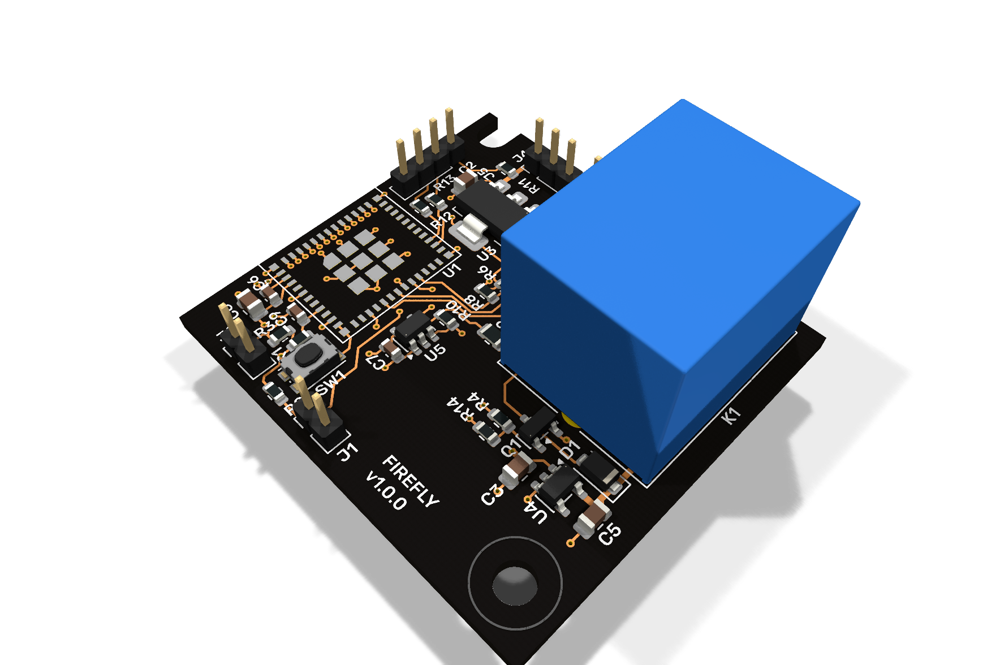
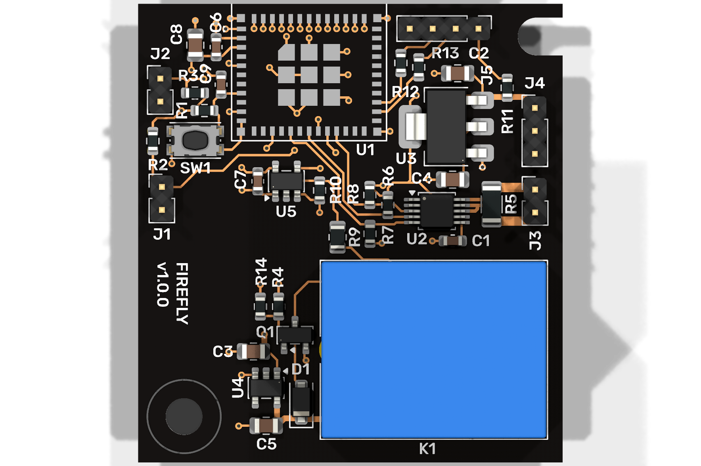
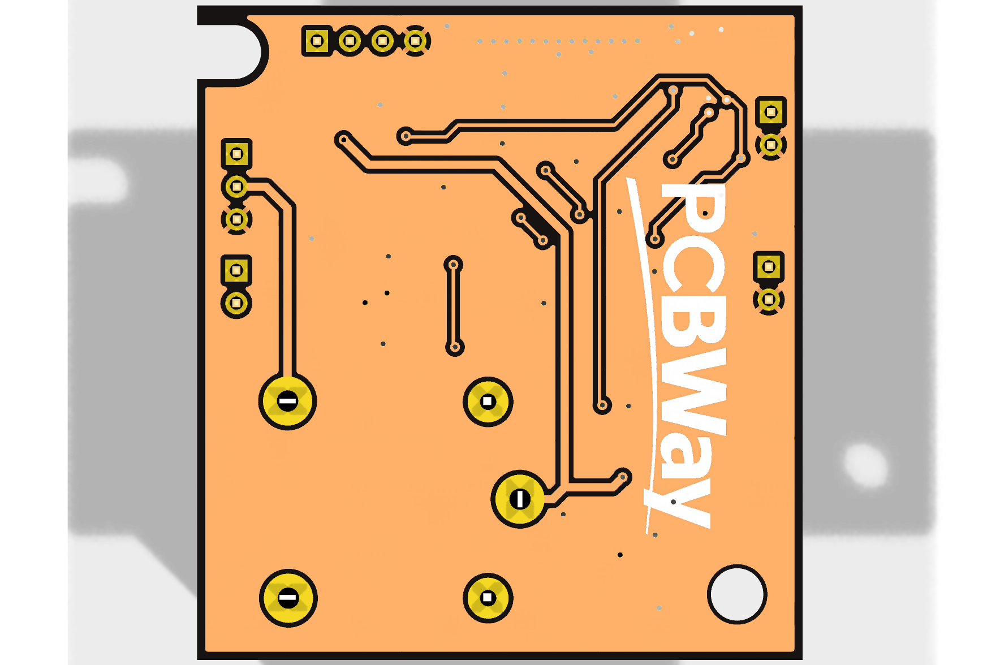

# FIREFLY — PCB de lámpara de emergencia

> Primer borrador de documentación de la placa. Las imágenes se generan directamente desde el archivo KiCad actual.

## Vista 3D

| Vista isométrica |
|---|
|  |

| Vista superior | Vista inferior |
|---|---|
|  |  |

La vista 3D no muestra el cuerpo del módulo U1 porque el modelo STEP configurado para el footprint no está disponible en la ruta local de KiCad. Sí se muestran sus pads, serigrafía y keepout.

## 1. Descripción

Esta PCB implementa el controlador y monitor de una lámpara de emergencia conectada por Zigbee. La placa integra:

- Un módulo inalámbrico **ESP32-H2-MINI-1** como controlador principal.
- Medición de corriente, tensión y potencia mediante **INA226**.
- Entrada de temperatura mediante un divisor con NTC.
- Simulación de pérdida de alimentación de la lámpara mediante un relé.
- Regulación local de `+7.5V` a `+5V` y `+3V3`.
- Conectores de prueba, NTC, sensado de corriente, alimentación y servicio USB.

El contacto del relé conmuta la señal de control `+7.5V` de la lámpara. Esta PCB no debe interpretarse como una etapa para conmutar directamente red de `220 VAC`.

## 2. Datos principales

| Parámetro | Valor |
|---|---|
| Nombre del diseño | FIREFLY |
| Revisión indicada en el proyecto | `v1.0.0` |
| Contorno de la PCB | `37 mm × 40 mm` |
| Capas de cobre utilizadas | `F.Cu` y `B.Cu` |
| Alimentación externa | `+7.5V` y `GND` mediante J4 |
| Comunicación inalámbrica | Zigbee / IEEE 802.15.4 mediante ESP32-H2 |
| Monitor de corriente | INA226, dirección I²C `0x40` |
| Shunt de corriente | R5 = `2 mΩ` |
| Relé | Songle `SRD-05VDC-SL-C`, bobina de `5V` |

## 3. Arquitectura eléctrica

```text
                           ┌───────────────┐
J4.1  +7.5V ───────────────┤ U3            ├── +3V3 ── U1 / U2 / U5
                           │ NCP1117-3.3  │
                           └───────────────┘
                                   │
                                   └───────────────┐
                                                   ▼
                           ┌───────────────┐    +5V ── K1 bobina
J4.1  +7.5V ───────────────┤ U4            ├─────────── D1 protección flyback
                           │ TPS76950     │
                           └───────────────┘

J4.2 señal AC ── R9/R10 ── U5 ── AC_STATUS ── U1 GPIO10

J3 VIN_P ── R5 2 mΩ ── VIN_N ── J3
              │       │
              └── U2 INA226 ── I²C ── U1 GPIO4/GPIO12

J2 NTC ── NTC_IN ── U1 GPIO1 / ADC1_CH0

U1 GPIO2 / EN_R ── R4 ── Q1 ── K1 bobina
                         │
                        R14
                         │
                        GND
```

### Dominios de alimentación

- `+7.5V`: entrada de la placa, alimentación de U3/U4 y señal que se entrega al controlador de la lámpara a través del contacto del relé.
- `+5V`: salida de U4 para la bobina de K1 y el circuito de protección asociado.
- `+3V3`: salida de U3 para U1, U2, U5, pull-ups y circuitos de señal.
- `GND`: retorno común de la lógica y de las fuentes de la placa.

## 4. Pinout del ESP32-H2-MINI-1

| Pin físico U1 | Señal en PCB | Función |
|---:|---|---|
| 3 | `+3V3` | Alimentación principal del módulo |
| 5 | `/EN_R` | Control del relé desde GPIO2 |
| 8 | `/EN_MCU` | Habilitación/reset del módulo |
| 10 | `/NTC_IN` | Medición del NTC, GPIO1 / ADC1_CH0 |
| 15 | `VBAT` | Nodo de alimentación interno del módulo; en la configuración por defecto no requiere alimentación externa |
| 16 | `/SCL` | I²C SCL, GPIO12 |
| 18 | `/SDA` | I²C SDA, GPIO4 |
| 19 | `/TEST_BUTTON` | Pulsador de prueba, GPIO5 |
| 20 | `/AC_STATUS` | Estado de presencia de AC, GPIO10 |
| 21 | `/ALERT` | Alerta del INA226, GPIO11 |
| 26 | `USB_D-` | USB D− mediante R13 de 22 Ω |
| 27 | `USB_D+` | USB D+ mediante R12 de 22 Ω |
| 1, 2, 11, 14, 36–53 | `GND` | Retorno y pad expuesto del módulo |

El firmware de `h2-emergency-light` utiliza el mismo contrato: SDA=`GPIO4`, SCL=`GPIO12`, relé=`GPIO2`, NTC=`GPIO1`, botón=`GPIO5`, `AC_STATUS`=`GPIO10` y `ALERT`=`GPIO11`.

El archivo del proyecto conserva el identificador de footprint `RF_Module:ESP32-C6-MINI-1`, aunque el símbolo, el valor y la asignación de pads corresponden al ESP32-H2-MINI-1. La equivalencia mecánica de la huella debe mantenerse documentada y verificada para el componente montado.

## 5. Función de los conectores

### J1 — TEST

| Pin | Señal | Función |
|---:|---|---|
| 1 | `/TEST_BUTTON` | Entrada del pulsador de prueba hacia U1 GPIO5 |
| 2 | `GND` | Retorno común |

### J2 — NTC

| Pin | Señal | Función |
|---:|---|---|
| 1 | `/NTC_IN` | Nodo del divisor NTC hacia U1 GPIO1 / ADC1_CH0 |
| 2 | `GND` | Retorno del sensor |

### J3 — Sensado de corriente

J3 expone los dos lados del shunt R5 para insertar el circuito de corriente de la lámpara y permitir que U2 mida la caída diferencial.

| Pin | Señal | Función |
|---:|---|---|
| 1 | `VIN_P` | Lado positivo del shunt, hacia INA226 VIN+ |
| 2 | `VIN_N` | Lado negativo del shunt, hacia INA226 VIN− y VBUS |

La polaridad y el sentido de corriente deben respetarse para que el signo de la medición sea el esperado por el firmware.

### J4 — POWER / señal de lámpara

| Pin | Señal | Función |
|---:|---|---|
| 1 | `+7.5V` | Entrada de alimentación de la placa y referencia para la señal de AC |
| 2 | `Net-(J4-Pin_2)` | Señal conmutada hacia el controlador de la lámpara; también alimenta el divisor R9/R10 para generar `AC_STATUS` |
| 3 | `GND` | Retorno de alimentación |

J4.2 es una señal DC de baja tensión. No debe conectarse directamente a la red eléctrica.

### J5 — USB / servicio

J5 es un header de servicio para programación o pruebas del módulo.

| Pin | Señal | Función |
|---:|---|---|
| 1 | `+7.5V` mediante R11 de 0 Ω | Alimentación expuesta del circuito de servicio |
| 2 | `USB_D-` mediante R13 de 22 Ω | USB D− hacia U1 GPIO26 |
| 3 | `USB_D+` mediante R12 de 22 Ω | USB D+ hacia U1 GPIO27 |
| 4 | `GND` | Retorno común |

El footprint de J5 está excluido actualmente de la BOM y todavía utiliza un conector genérico. Si se montará físicamente, debe definirse su número de parte y confirmar la orientación del cableado antes de fabricar.

## 6. Bloques funcionales

### U1 — ESP32-H2-MINI-1

Controlador Zigbee de la lámpara. Gestiona el relé, el botón de prueba, la temperatura, el estado de alimentación y las mediciones del INA226.

`VBAT` corresponde al nodo de alimentación interno del módulo. Según la configuración por defecto del ESP32-H2-MINI-1, está conectado internamente a la alimentación de 3,3 V; no se debe añadir una fuente externa independiente a ese pin.

### U2 — INA226AIDGSR

Monitor de corriente y potencia por I²C. Usa dirección `0x40`, pull-ups en SDA/SCL y una resistencia shunt R5 de `2 mΩ`. La alerta se entrega a U1 mediante `/ALERT`.

### U3 — NCP1117ST33T3G

Regulador lineal de `+7.5V` a `+3V3`. C3 y C4 proporcionan el filtrado de entrada y salida.

### U4 — TPS76950DBVR

Regulador lineal de `+7.5V` a `+5V`. Su salida alimenta la bobina de K1 y el circuito de rueda libre.

### U5 — NC7SZ125M5X

Buffer lógico alimentado a `+3V3`. Convierte el nivel del divisor R9/R10 en una señal limpia de `3.3V` para `AC_STATUS`/GPIO10. OE está fijado a GND para mantenerlo habilitado.

### K1, Q1 y D1 — simulación de pérdida de AC

K1 es un relé SPDT Songle `SRD-05VDC-SL-C`. Q1, controlado por U1 GPIO2 mediante R4, conmuta la bobina; R14 mantiene la compuerta en estado apagado durante reset y D1 absorbe el pulso inductivo.

La intención funcional es que el contacto normalmente cerrado mantenga presente `+7.5V` en J4.2 cuando el relé está desenergizado. Al energizar K1, el contacto se abre y la lámpara interpreta una pérdida de alimentación.

**Nota de montaje:** confirmar la correspondencia entre la numeración física del Songle y el footprint antes de liberar Gerbers. El número de pin del símbolo genérico de KiCad no sustituye la verificación contra el dibujo del fabricante.

## 7. Componentes de soporte relevantes

| Referencia | Valor | Función |
|---|---:|---|
| C1, C6, C7 | 100 nF | Desacoplo local de U2, U1 y U5 |
| C2–C5, C8 | 10 µF | Filtrado y reserva en los reguladores y U1 |
| C9 | 1 µF | Retardo RC de `/EN_MCU` junto con R1 de 10 kΩ |
| R1–R3, R6–R8, R10 | 10 kΩ | Pull-ups y polarización de señales |
| R4 | 3.3 kΩ | Resistencia serie de compuerta de Q1 |
| R5 | 2 mΩ | Shunt de medición de corriente |
| R9 | 12.4 kΩ | Rama superior del divisor de `AC_STATUS` |
| R11 | 0 Ω | Enlace de alimentación hacia J5; selección actual del proyecto |
| R12, R13 | 22 Ω | Terminación serie de USB D+/D− |
| R14 | 100 kΩ | Pull-down de compuerta de Q1 |

## 8. Estado del borrador

La documentación corresponde al estado actual de los archivos KiCad y no sustituye una liberación de fabricación. Antes de fabricar conviene completar estas comprobaciones:

- Sincronizar el pad 15 de U1 entre esquemático y PCB después de modelar `VBAT` como conexión interna/no externa.
- Confirmar la numeración física de K1, especialmente la pareja de pines de bobina y los contactos COM/NC/NO.
- Confirmar que J5 será montado; si no se utiliza, marcarlo explícitamente como no poblado.
- Repetir ERC/DRC con paridad esquemático–PCB después de cualquier sincronización.
- Revisar las excepciones intencionales de serigrafía alrededor de U1 y el keepout de antena durante la revisión mecánica final.
- Generar Gerbers, taladros y archivos de posición únicamente después de cerrar esas comprobaciones.

## 9. Archivos del proyecto

- [Proyecto KiCad](emergency-light-pcb.kicad_pro)
- [Esquemático principal](emergency-light-pcb.kicad_sch)
- [Hoja jerárquica del INA226](INA226.kicad_sch)
- [PCB](emergency-light-pcb.kicad_pcb)
- [Reporte de revisión de activos](REPORTE_REVISION_ACTIVOS_2026-09-07.md)
- [Reporte de revisión del circuito](REPORTE_REVISION_CIRCUITO.md)

Las imágenes utilizadas en este README están en [`docs/render/`](docs/render/).

