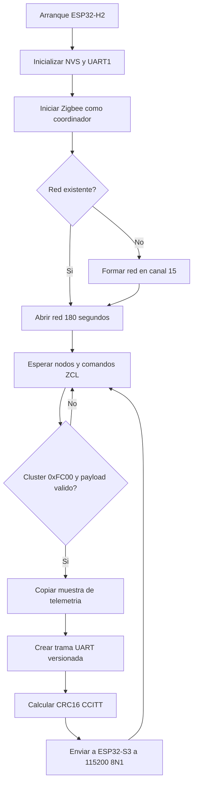

# ESP32-H2 - Coordinador Zigbee

Forma la red Zigbee, recibe telemetria de los nodos y la envia al ESP32-S3 por
UART con framing y CRC16.

## Pinout

| Funcion | GPIO ESP32-H2 | Conexion |
|---|---:|---|
| UART1 TX | GPIO12 | ESP32-S3 GPIO17 (RX) |
| UART1 RX | GPIO4 | ESP32-S3 GPIO18 (TX), reservado para comandos futuros |
| GND | GND | GND del ESP32-S3 |
| USB D- | GPIO26 | Programacion y monitor USB-JTAG |
| USB D+ | GPIO27 | Programacion y monitor USB-JTAG |

GPIO13 y GPIO14 se evitan porque pueden estar ocupados por el cristal de 32.768
kHz del modulo H2. La UART trabaja a niveles de **3.3 V**. No se debe usar un adaptador RS-232 ni
aplicar 5 V. El cruce obligatorio es TX H2 a RX S3 y RX H2 a TX S3.

## Funcionamiento

- Coordinador Zigbee en canal 15.
- Red abierta durante 180 segundos al crearla o reiniciar.
- Cluster privado `0xFC00`, endpoint 1.
- UART 115200 8N1 y CRC16/CCITT-FALSE.

El formato completo esta en `../PROTOCOL.md`.

## Flujo del firmware



## Compilar

```bash
source ~/esp/esp-idf/export.sh
idf.py set-target esp32h2
idf.py build
idf.py -p /dev/ttyACM0 flash monitor
```
