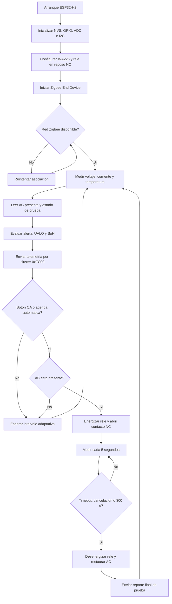

# ESP32-H2 - Nodo de luminaria

Firmware ESP-IDF para medir la bateria SLA de 6 V y enviar telemetria al
coordinador por Zigbee 3.0.

## Pinout

| Funcion | GPIO ESP32-H2 | Conexion |
|---|---:|---|
| I2C SDA | GPIO12 | INA226 SDA |
| I2C SCL | GPIO4 | INA226 SCL |
| INA226 ALERT | GPIO11 | ALERT, activo bajo; pull-up a 3.3 V |
| NTC ADC | GPIO1 / ADC1_CH0 | Punto medio del divisor NTC |
| AC presente | GPIO10 | Entrada activa-alta 3.3 V desde circuito aislado |
| Control de rele | GPIO22 | Entrada del driver de bobina, activo alto |
| Boton TEST | GPIO5 | Pulsador a GND, pull-up interno |
| USB D- | GPIO26 | Programacion y monitor USB-JTAG |
| USB D+ | GPIO27 | Programacion y monitor USB-JTAG |

El divisor NTC esperado es `3.3 V -> 10K fija -> GPIO1 -> NTC 10K B3950 -> GND`.
GPIO10 **no puede conectarse directamente a 220 V ni a 12 V**. La PCB debe
entregar una senal aislada o acondicionada de 0 a 3.3 V. El firmware habilita
pull-down para que una entrada desconectada se interprete como AC ausente.

## Rele de prueba de bateria

El contacto **normalmente cerrado (NC)** del rele se coloca en serie con la fase
que alimenta exclusivamente a la luminaria. En reposo la bobina esta apagada y
la lampara recibe AC. Al pulsar `TEST`, GPIO22 energiza la bobina durante 30
segundos y abre el contacto, obligando a la luminaria a funcionar con bateria.
Una segunda pulsacion cancela la prueba. El firmware limita cualquier prueba a
un maximo absoluto de 300 segundos. El inicio y el final despiertan inmediatamente
la tarea de telemetria para que ambos estados sean reportados sin esperar el
intervalo normal de 60 segundos.

El boton se conserva como alternativa manual para QA y mantenimiento. La
operacion normal no requiere acceso fisico: el coordinador C6 programa campanas
automaticas y asigna cada H2 a un grupo. El nodo persiste la agenda en NVS,
espera su retardo, abre el rele durante 30 s y mide cada 5 s. El timeout se
controla localmente, por lo que el rele vuelve a NC aunque se pierda Zigbee.

Al terminar se reportan tension previa, tension minima, corriente promedio y
pico, potencia promedio, temperatura maxima y resultado `PASS`/`FAIL`. Los
umbrales iniciales son 5.25 V de tension minima y 50 mA de corriente minima. Un
reporte que no pueda transmitirse se conserva en NVS y se reintenta al recuperar
la red.

GPIO22 no puede alimentar una bobina. La PCB necesita, como minimo:

- Driver de transistor o MOSFET dimensionado para la bobina.
- Diodo flyback sobre una bobina DC.
- Aislamiento galvanico entre control SELV y contactos de red.
- Rele con contacto NC certificado para 250 VAC y la corriente de la luminaria.
- Fusible, distancias de fuga y separacion conforme a la normativa aplicable.

La conmutacion de 220 VAC cambia el alcance de seguridad del producto y debe ser
revisada por un especialista. El H2, el USB y los sensores nunca deben compartir
una conexion electrica directa con la red AC.

Se evitan GPIO8, GPIO9 y GPIO25 porque son strapping pins; GPIO15 a GPIO21 se
reservan para la flash interna del modulo. GPIO13 y GPIO14 tampoco se usan porque
pueden estar conectados al cristal de 32.768 kHz dentro del ESP32-H2-MINI-1.

## INA226

- Direccion I2C: `0x40`.
- Shunt del modulo: `R010` (10 mOhm).
- Current LSB: 100 uA.
- Registro de calibracion: 5120 (`0.00512 / (100 uA * 10 mOhm)`).
- Corriente positiva: descarga; si el montaje entrega el signo opuesto, invierta
  `IN+`/`IN-` o ajuste el signo en firmware despues de validar el prototipo.

Si el INA226 no responde durante el arranque, el firmware registra una advertencia
pero mantiene activos Zigbee y el control fail-safe del rele. Las medidas se
publican con `sensor_valid=false`, sin generar una falsa alerta UVLO por valores
en cero. El arranque escanea todo el bus y acepta automaticamente las direcciones
INA226 `0x40` a `0x4F`. Revise alimentacion, GND, SDA y SCL si no aparece ninguna.

El INA226 no limita electricamente la corriente. A 1.06 A, el shunt `R010`
solo debe producir unos 10.6 mV de caida y disipar unos 11 mW. Si al insertar
el modulo la corriente cae de forma apreciable, mida con la carga encendida:

1. Tension directamente entre `IN+` e `IN-`: debe ser cercana a 10.6 mV a
   1.06 A.
2. Tension entre bateria positiva y entrada positiva de la lampara, incluyendo
   modulo, cables y conectores: una caida mucho mayor identifica una conexion
   resistiva o un recorrido incorrecto.
3. Corriente con multimetro e INA226 simultaneamente en serie: comparar pruebas
   hechas sustituyendo el modulo no permite separar un error de calibracion de
   una limitacion fisica.

La corriente de la lampara debe circular exclusivamente por los terminales de
potencia `IN+` e `IN-`, con cables cortos y adecuados para mas de 1 A. No debe
circular por `VCC`, GND ni por cables Dupont de senal.

## Zigbee

El dispositivo funciona como Zigbee End Device, usa canal 15 y envia el comando
privado descrito en `../PROTOCOL.md` al coordinador `0x0000`. Reporta cada 60 s,
30 s bajo 5.85 V y 10 s ante alerta. La primera version mantiene el stack Zigbee
activo; deep sleep se habilitara tras medir el consumo y validar la persistencia
de red en hardware.

## Flujo del firmware



## Compilar

```bash
source ~/esp/esp-idf/export.sh
idf.py set-target esp32h2
idf.py build
idf.py -p /dev/ttyACM0 flash monitor
```
