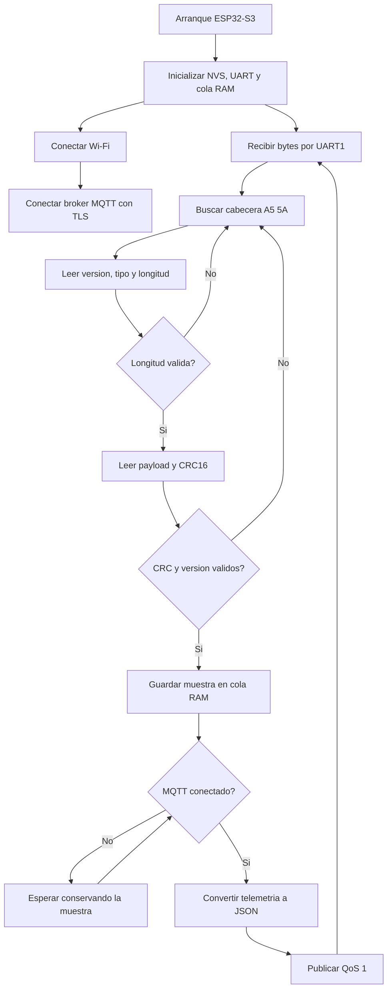

# ESP32-S3 - Gateway Wi-Fi/MQTT

Recibe tramas del coordinador H2, valida framing y CRC16, conserva hasta 32
muestras en RAM durante una desconexion y publica JSON mediante MQTT/TLS.

## Pinout

| Funcion | GPIO ESP32-S3 | Conexion |
|---|---:|---|
| UART1 RX | GPIO17 | ESP32-H2 GPIO12 (TX) |
| UART1 TX | GPIO18 | ESP32-H2 GPIO4 (RX), reservado para comandos futuros |
| GND | GND | GND del ESP32-H2 |
| USB D- | GPIO19 | USB nativo, si la placa lo expone |
| USB D+ | GPIO20 | USB nativo, si la placa lo expone |

Los pines GPIO17 y GPIO18 son la asignacion del firmware y deben comprobarse
contra el modelo exacto de la placa ESP32-S3 antes de fabricar el cable o PCB.
La UART es 3.3 V, 115200 baud, 8N1.

## Configuracion

```bash
source ~/esp/esp-idf/export.sh
idf.py set-target esp32s3
idf.py menuconfig
```

En `Emergency gateway configuration` configure:

- SSID y clave Wi-Fi.
- URI `mqtts://host:8883`.
- Usuario y clave MQTT.
- Prefijo del topic.

Se usa el bundle de certificados raiz de ESP-IDF para validar el servidor TLS.
Para una CA privada sera necesario incorporar su certificado PEM al firmware.
Las credenciales guardadas en `sdkconfig` no deben subirse a control de versiones.
El proyecto usa una particion de aplicacion de 1792 KiB sobre una flash minima de
2 MiB para dejar margen al stack Wi-Fi/TLS. OTA se incorporara en una fase
posterior con una tabla dimensionada para la flash real del modulo S3.

## Topic y JSON

Topic:

```text
emergency-lights/<device_id>/telemetry
```

El JSON contiene voltaje, corriente, potencia, temperatura, AC presente, alertas,
UVLO, estado de prueba, SoH y contador de secuencia. MQTT usa QoS 1.

## Flujo del firmware



## Compilar

```bash
idf.py build
idf.py -p /dev/ttyACM0 flash monitor
```
